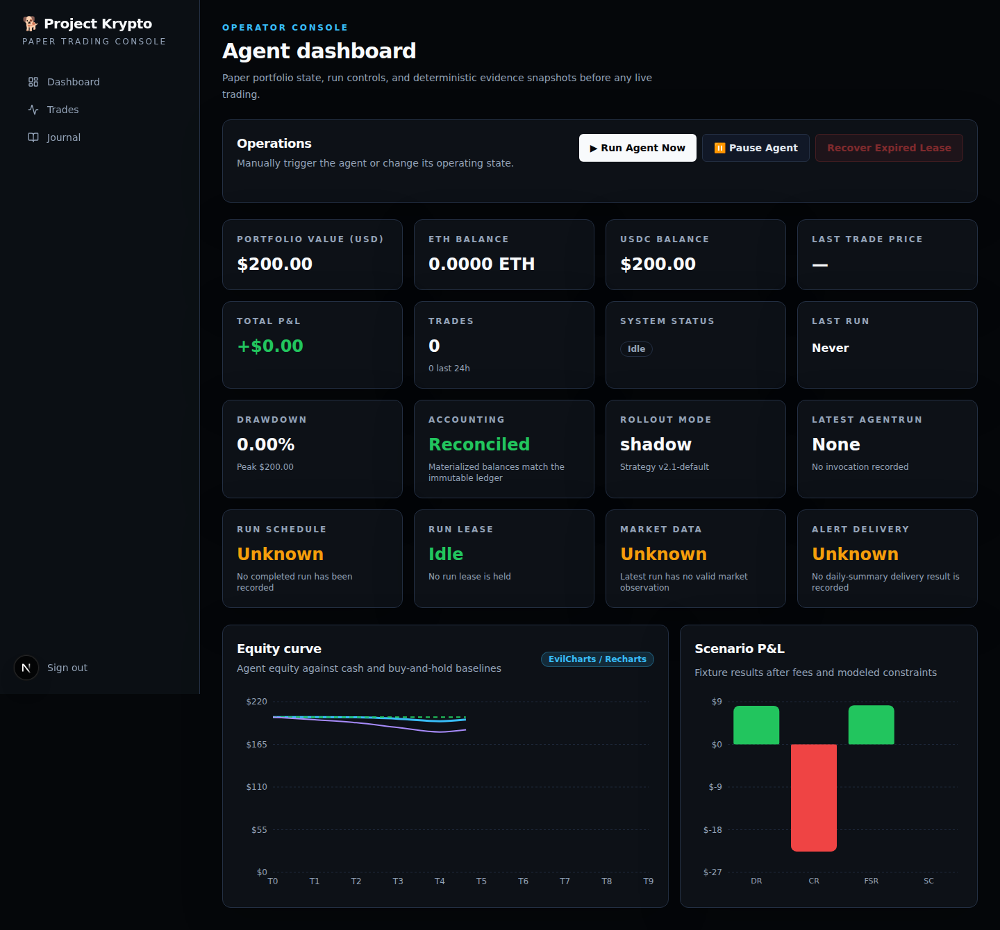
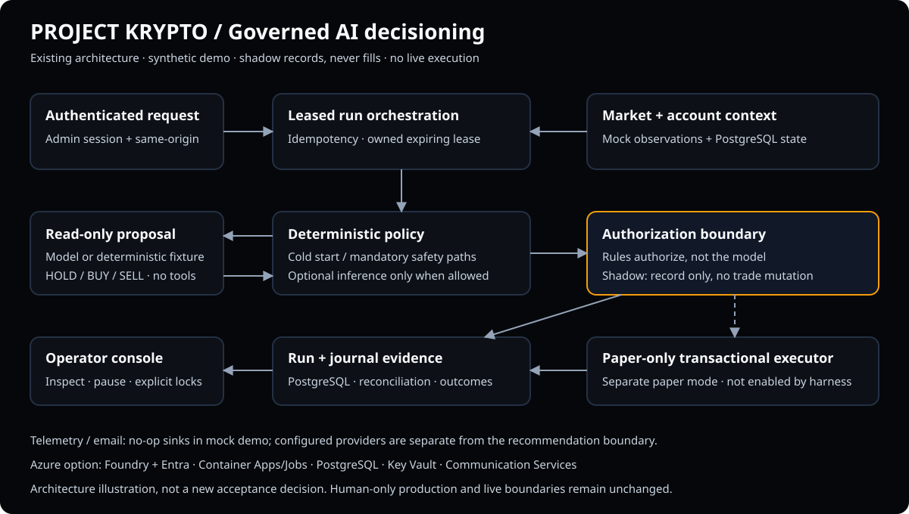

# Project Krypto — Governed AI Decisioning Sandbox

```text
+--------------------------------------------------------------------------------------+
|                            P R O J E C T   K R Y P T O                               |
|                                                                                      |
|          /^-----^\                              /\                    |       |      |
|         V  o o  V                             /  \              |    |   |   |       |
|          |  Y  |                             / /\ \            _|_  _|_ _|_ _|_      |
|           \ Q /             __              / /  \ \            |    |   |   |       |
|       ____/ - \____     _.-'  `-._         /_/____\_\      _____|____|___|___|_____  |
|    .-' ___| K |___ `---'          `-.     <___ ETH ___>    MARKET: ETH / USDC        |
|   /_.-'   |___|   `-._               \     \ \    / /                                |
|         _/ / \ \_      `---------------'     \ \  / /     PAPER ONLY // SAFETY FIRST |
|        (__/   \__)                            \ \/ /                                 |
|                                                \  /                                  |
|                                                 \/                                   |
|                                                                                      |
|                    SUPER-DOG INSTINCTS. HARD-CODED GUARDRAILS.                       |
+--------------------------------------------------------------------------------------+
```

**AI advice. Deterministic rules. Operator control.**

Explore how structured AI recommendations become controlled, auditable workflow
outcomes using synthetic ETH/USDC scenarios. Start with the isolated mock/shadow
demo: **no Azure account or real-provider credentials required**.

> **Paper only.** No live trading, wallets, custody, or exchange orders. The model
> has no mutating trade tool. This engineering demonstration is not investment
> advice, a return forecast, or authorization for production deployment.

| Accelerator readiness | Assessment |
|---|---|
| Customer / industry | Reusable, cross-industry; financial-services example (assumption to confirm) |
| Primary audience | AI platform engineers and solution architects; SEs/CSAs, product owners, and security leads |
| Current / target | Locally demonstrated; **not field-ready or catalog-ready** / catalog-ready |
| Top three sharing gates | Independent SE/CSA handoff; owner-approved license/support/publication; catalog schema verification and narrated recording |
| Stack | Next.js 16 · TypeScript · structured model output · deterministic authorization · Drizzle/PostgreSQL |
| Evidence | [Synthetic demo assets and provenance](./docs/assets/accelerator/evidence.json) |
| Catalog metadata | [Draft accelerator.yaml](./accelerator.yaml), not a validated submission |



*Captured from an isolated local harness, not a customer or production account.
Charts are engineering fixtures, not the history of the displayed account.*

## Customer story

AI platform teams want to move from impressive model answers to dependable
business workflows. Today, they struggle to prove that a recommendation respects
operating rules, produces an auditable outcome, and remains under operator
control. Project Krypto makes those challenges tangible: a model proposes an
action while deterministic software decides what is permitted. Synthetic
scenarios let customers explore that separation before selecting a workflow of
their own.

## Try the local demo

**Prerequisites:** Node.js 22 matching [`.nvmrc`](./.nvmrc), npm, Docker with
Compose, and a running Docker daemon. Dependency, container-image, and browser
downloads initially require network access. Mock application providers make no
Foundry or Coinbase calls; analytics/email use no-op sinks.

Run from the checked-out repository root:

```bash
npm ci
npm run harness:up -- --shadow --scenario dip --decision BUY
npm run harness:status
```

Open the **Console URL printed by the harness**, including its dynamically
allocated port. Use `127.0.0.1`, not a substituted hostname: the harness explicitly
binds the allowed admin origin to that URL. Sign in with the fixture-only password
`harness-admin-password`; never reuse it on a deployed environment.

No `.env` copy or cloud secrets are needed. Use a clean checkout without real
credentials or environment files for customer demos. The harness initializes an
isolated PostgreSQL database and allows only disabled/shadow modes.

1. Verify `harness:status` reports `harnessMode: mock` and `rolloutMode: shadow`.
2. Wait for the dashboard to finish loading, then click **Run Agent Now**.
   A fresh account first returns a cold-start **HOLD** and establishes its
   reference price without inference.
3. Click **Run Agent Now** again. The deterministic provider proposes **BUY**,
   but policy rejects it because the constant scenario price has not dropped
   below the newly established reference. The UI reports `Run shadow`;
   the persisted authorization—not that label—explains the rejection.
4. Open **Journal** to inspect the proposal/context and **Trades** to verify no
   trades were executed. Shadow mode records runs and may update reference/
   mark-to-market state; it is not a wholly read-only database session.

**Repeatable browser evidence** (against the already-running local harness):

```bash
npx playwright install --with-deps chromium
npm run harness:browser
```

The browser suite captures safety states, console, decision, journal, empty
trade ledger, and raw silent video. It checks authenticated run success,
cross-origin rejection, persisted proposals, and unchanged trade count.
The safety test temporarily sets locked/paused fixtures in the isolated database
and restores them; it does not prove that a crash caused a drawdown lock.
Never target these tests at a customer or deployed database.

**Cleanup:**

```bash
npm run harness:down
```

Cleanup deletes the harness database volume; logs/screenshots remain in the
ignored `.harness/` directory. To start a different scenario, stop first and
start again. Do not use `db:reset` against a shared or deployed database.

## End-to-end journey and architecture



1. **Request:** “How can AI recommend actions without unrestricted authority?”
2. **Inputs:** Select synthetic market observations and a deterministic proposal.
3. **Context:** Load account state, limits, mode, pause/lock state, and run identity.
4. **Workflow:** Claim an owned expiring lease and evaluate deterministic policy.
   Cold starts and mandatory safety paths may bypass the model entirely.
5. **Proposal:** When inference is allowed, validate one structured
   `HOLD`, `BUY`, or `SELL`; the model receives no mutating trade tool.
6. **Authorization:** Apply deterministic rules. Shadow records a decision/
   authorization without a fill; only the separate paper path can execute a
   simulated fill transactionally.
7. **Outcome:** Inspect run evidence, journal, and operator state.
8. **Next action:** Choose one synthetic-data customer workflow for discovery.

The diagram describes existing boundaries; it is not acceptance of a new
architecture. Product and authority remain defined by the canonical specs below.

## What it does

When scheduling is enabled, an hourly job hits `POST /api/agent/run`. The route:

1. Creates or idempotently recovers an `AgentRun`, then claims an owned,
   expiring account lease.
2. Applies the configured `disabled`, `shadow`, or `paper` rollout mode.
3. Fetches validated Coinbase data, marks the account to market, and computes
   deterministic cold-start, stop-loss, drawdown, cooldown, sizing, DCA,
   exposure, and take-profit eligibility.
4. Executes mandatory safety exits without the model. For optional actions,
   requests exactly one structured `HOLD`, `BUY`, or `SELL` proposal from the
   dedicated Foundry-hosted OpenAI `gpt-5.6-luna` deployment with bounded
   timeout/retry behavior and Microsoft Entra authentication.
5. Re-authorizes every invariant against a freshly locked database row. In
   paper mode, the trade, fixed-point accounting transition, run outcome, and
   reconciliation state commit atomically and idempotently.
6. Persists the journal/run result, emits and flushes telemetry, and releases
   only the lease owned by that invocation.

A separate daily-summary job emails the previous 24h of trades + PnL through
the environment's Azure Communication Services Email resource.

## Present the demo

### Five-minute flow

| Time | Presenter action | Expected message/evidence |
|---|---|---|
| 0:00–0:45 | Introduce customer problem and architecture | “A recommendation is not permission to act.” |
| 0:45–1:30 | Open mock/shadow console | Identify mode, fixture balances, no real account |
| 1:30–3:00 | Run twice using the walkthrough above; open Journal | Cold-start HOLD, then BUY proposal rejected; no fill |
| 3:00–4:15 | Show captured paused/locked safety fixture | Explicit operator controls; not a crash-induced lock |
| 4:15–5:00 | Map boundaries to a customer process | Agree on a discovery next step |

### Fifteen-minute flow

| Time | Presenter action |
|---|---|
| 0–2 min | Agree on the business problem and demo success criteria |
| 2–4 min | Walk the model/authorization/data trust boundaries |
| 4–8 min | Show the complete shadow request, context, proposal, and outcome |
| 8–11 min | Show synthetic safety-state evidence; discuss mandatory paths |
| 11–13 min | Explain engineering scenarios, evaluation limits, reproducibility |
| 13–15 min | Complete the customer adaptation worksheet and agree on a pilot |

**Success:** another SE/CSA can reproduce the journey without the author;
the audience distinguishes proposal from permission; trade count stays zero;
no production change or real customer data is required.

### Screenshots and recording

| Asset | Caption / interpretation |
|---|---|
| [Console](./docs/assets/accelerator/hero.png) | Mock providers, shadow mode, synthetic $200 account |
| [Decision outcome](./docs/assets/accelerator/decision.png) | Recorded run; `Run shadow` does not mean authorization succeeded |
| [Journal](./docs/assets/accelerator/journal.png) | Synthetic market context and deterministic BUY proposal |
| [Safety states](./docs/assets/accelerator/safety.png) | Locked/paused browser-test fixture; no destructive action performed |
| [Trade ledger](./docs/assets/accelerator/trades.png) | No trades after the shadow journey |
| [Raw walkthrough](./docs/assets/accelerator/walkthrough.webm) | Short silent automated capture, **not** the final narrated five-minute video |
| [Recording captions](./docs/assets/accelerator/narration.vtt) | Five-minute narration/caption draft for the presenter; not synchronized to the raw clip |
| [Evidence index](./docs/assets/accelerator/evidence.json) | Capture provenance, source hashes, validation, and remaining gates |

For the final recording, use the five-minute flow, add spoken narration and
synchronized captions, and include synthetic-data/safety disclaimers and the CTA.
Human recording and publication approval remain open. If a live demo fails,
use these clearly labeled captures; never imply prerecorded evidence is live.

## Sample scenarios and limitations

| Harness scenario | Synthetic final spot | Fresh-account behavior |
|---|---|---|
| `steady` | $2,000 | First run initializes reference; later HOLD/BUY/SELL proposal depends on `--decision` |
| `dip` | $1,900 | First run sets reference to $1,900, not $2,000; unchanged price cannot authorize BUY |
| `crash` | $1,500 | A flat $200 account has no ETH drawdown; this alone does not demonstrate a stop-loss |

Each scenario supplies 100 synthetic closes with a $2,000 baseline and the final
price shown above. `--decision` configures a fixture proposal, not policy
permission. These are static provider fixtures, not advancing market replays.
For richer deterministic paper simulations use
`npm run backtest -- --scenario scenarios/crash-rebound.json` or
`npm run backtest:all`; those are separate engineering evaluations, not the
displayed shadow account or investment-performance claims.

## Reuse and customer adaptation

| Reusable pattern | Customer-specific work |
|---|---|
| Structured recommendation contract | Define permitted outputs and context schema |
| Deterministic authorization boundary | Define business rules, forbidden actions, approval owners |
| Idempotency, leases, outcome evidence | Map transaction boundaries and retention requirements |
| Operator modes, pause/lock visibility | Define identity, permissions, domain terminology |
| Mock-first harness and scenarios | Supply synthetic, approved test cases |
| Evaluation and infrastructure patterns | Choose acceptance measures, region/model availability, networking and cost |

Do not treat trading policy as a generic financial recommendation engine.
Adaptation is a separately reviewed implementation, not permission to remove
guardrails or enable live execution.

**Customer worksheet:** record the process owner, request, required context,
permitted proposal, deterministic checks, human approval point, useful output,
audit/retention needs, synthetic happy-path/failure cases, and next action.
Agree measurable acceptance criteria before testing.

**Publication scrub:** review environment URLs, resource names, historical
account links, email addresses, telemetry IDs, logs, and images. Use approved
synthetic equivalents. Do not export browser traces, cookies, `.env`, real
datasets, or raw operational reports into the sharing package. Existing
infrastructure/history also needs owner review before redistributing the full
repository; sanitized demo assets are not a repository-wide security clearance.

## Customer engagement

**Account-team opener:** “AI may already produce useful recommendations. Can
you prove what happens next—what the model can influence, which controls enforce
the rules, and what an operator can inspect or stop?”

**Discovery questions:**

1. Which recommendations require people to gather context and act today?
2. What makes an incorrect action unacceptable?
3. Which rules must remain deterministic?
4. What evidence must be retained for audit or incident response?
5. Where must human approval remain mandatory?
6. Can we evaluate the workflow using synthetic data?
7. Who owns the process, platform, and risk decision?
8. What measurable outcome would justify a pilot?

**Workshop:** bring a process owner, platform engineer, and security/risk
representative to map one recommendation-to-action workflow. Produce a workflow
map, control matrix, synthetic scenarios, acceptance criteria, and a
non-production pilot backlog.

**Pilot scorecard:** one end-to-end workflow; every decision linked to context
and outcome; all predefined forbidden-action tests blocked; independent setup
and cleanup; no unauthorized access or production changes; customer-specific
business measures agreed before evaluation.

**CTA:** Choose one workflow and nominate a process owner plus platform engineer
for a discovery session.

## Scripts

| Command | What it does |
|---|---|
| `npm run dev` | Next.js dev server with Turbopack |
| `npm run build` | Production build (also typechecks) |
| `npm run start` | Run the production build |
| `npm run lint` | ESLint over the project |
| `npm test` | Jest unit + integration tests |
| `npm run test:unit` | Deterministic Jest suite in one process |
| `npm run test:coverage` | Jest plus enforced critical-module coverage gates |
| `npm run test:integration` | Real-PostgreSQL migration and execution suite |
| `npm run test:watch` | Jest watch mode |
| `npm run db:generate` | Generate Drizzle migration SQL from schema changes |
| `npm run db:migrate` | Run committed migrations using `DIRECT_URL` |
| `npm run db:init` | Idempotently initialize the `AgentState` singleton |
| `npm run test:migrations` | Real-PostgreSQL migration, privilege/tamper, decimal, transaction, lease, run-flow, preflight, and backup tests |
| `npm run db:studio` | Drizzle Studio (browse the DB) |
| `npm run smoke:llm` | Verify Foundry model access without tools or trading |
| `npm run deployment:preflight` | Prove the Azure runtime/direct DB identity, exact schema/migration state, leases, ACLs, and retirement of legacy database-side objects |
| `npm run deployment:backup -- --out <dir>` | Bind `DATABASE_URL`/`DIRECT_URL`, refuse active legacy scheduler/queued HTTP state and migration-only targets, create checksummed archives, and optionally prove a local restore |
| `npm run smoke:target -- --base-url <url> --confirm-host <host>` | Bind runtime/direct DB and scheduler auth, prove mismatched-mode rejection plus disabled runs, admin/postconditions, ACS Email, Luna/Entra, Coinbase, and PostHog |
| `npm run backtest -- --scenario scenarios/dip-recovery.json` | Run deterministic paper scenario evaluation |
| `npm run backtest:all` | Emit aggregate JSON for every engineering scenario |
| `npm run evidence:import -- --input <dataset.json> --out <materialized.json>` | Strictly validate and hash a versioned JSON evidence dataset |
| `npm run evidence:import -- --input <observations.csv> --manifest <manifest.json> --out <materialized.json>` | Import strict `timestamp,priceUSD` CSV observations with an explicit manifest/gap descriptor |
| `npm run evidence:evaluate -- --dataset <materialized.json> --plan <plan.json> --json-out <report.json> --html-out <report.html>` | Run predeclared isolated walk-forward windows through the production-aligned backtest runner |

Evidence datasets and reports are internal simulation artifacts. Keep real or
large source datasets and generated reports outside git; only tiny deterministic
fixtures belong in `tests/fixtures/evidence/`. Holdout datasets may be evaluated
but are rejected by the parameter-sweep/tuning guard. Evaluation plans require
the raw source-file hash, deterministic complete-materialization hash, a
lowercase 40-hex implementation commit SHA, and a `declaredAt` timestamp
strictly before the first evaluation window. The materialization hash binds the
recorded JSON/CSV import format and both dataset hashes while preserving semantic
canonical equivalence. The commit and declaration time are operator-declared
unless externally bound by retained CI artifact metadata; the evaluator never
shells out to Git. Source metadata and `sourceFileSha256` are likewise
importer/operator-declared because standalone evaluation does not retain the raw
bytes needed for independent recomputation or authenticity verification.
Imported reports are always `engineering-only` and `releaseGateEligible: false`,
regardless of performance.

## Project layout

```
src/
  app/                    # Next.js App Router
    api/agent/run/        # POST /api/agent/run    — main agent loop entry
    api/agent/daily-summary/  # POST — daily PnL email
    api/auth/{login,logout}/  # Admin cookie auth
    api/admin/*              # Admin operations: run, pause, lease recovery, audited unlock
    admin/{,trades,journal,login}/  # Server-rendered dashboard
  agent/                  # Structured decision generation and run orchestration
  trading/                # Deterministic policy, fixed-point accounting, paper executor
  db/                     # Drizzle schema + client
  guardrails/             # Legacy/admin guardrail helpers
  lib/                    # Indicators, analytics, email, config, types
  proxy.ts                # Admin route protection
drizzle/                  # Generated migrations
infra/                     # Bicep platform account/model/access, dev/prod foundation,
                           # release, rollout, and schedule monitoring
.github/workflows/azure-* # OIDC platform/access, validation, deploy, and rotation flows
specs/                    # Five canonical product/operations/evaluation/factory/governance specs
scripts/                  # One-shot scripts (seed, etc.)
tests/                    # Jest unit + integration tests
```

## Deploying

The local demo does not deploy anything to Azure. For an optional read-only
provider check, follow `npm run smoke:providers -- --allow-network-smoke` with
authorized Foundry/Entra configuration; this requires network access and is not
part of the credential-free demo.

For authorized Azure work, use the existing
[infrastructure runbook](./infra/README.md) and
[operations specification](./specs/operations.md), not a one-click catalog
deployment. They cover Bicep, OIDC/managed identity, PostgreSQL, Key Vault,
Container Apps/Jobs, email, evidence, monitoring, and fail-closed rollback.
An owner must confirm subscription access, model/region availability, networking,
cost/budget, resource ownership, and cleanup before provisioning. Azure resources
incur charges; `harness:down` removes local resources only.

**Deployment history is not current readiness evidence.** Earlier documents
disagreed about whether GitHub environment required reviewers were enforceable.
Their current enforcement has not been independently verified for this package.
An authorized owner must inspect environment protections and record dated
evidence before deployment; unknown enforcement is a blocker, not permission to
bypass approval. No production promotion workflow is authorized here.
Production deployment, secrets/accounts, architecture acceptance, and live
enablement remain human-only; production must remain disabled/manual under
the existing [governance rules](./specs/governance.md).

## Local testing

Run the narrowest checks from [AGENTS.md](./AGENTS.md):

```bash
npm run lint
npm run typecheck:scripts
npm run build
npm test -- --runInBand tests/harness tests/lib/csrf.test.ts
```

`npm run test:coverage` runs the broader deterministic suite;
`npm run test:integration` additionally requires disposable PostgreSQL and its
documented client prerequisites. Builds and tests are engineering evidence,
not production promotion or investment-performance approval.

Existing [CI](./.github/workflows/ci.yml) performs quality, coverage,
PostgreSQL, dependency-audit, and harness-integrity checks. This package adds no
deployment automation or workflow permissions. The browser journey is currently
an explicit local check, not a claimed mandatory CI gate. Before adding a
demo-evidence CI job, review isolated database lifecycle, permissions,
sanitization, and retention; do not upload traces or secrets.

## Troubleshooting and support

| Symptom | Safe next step |
|---|---|
| Docker unavailable | Start the daemon; verify `docker info` and `docker compose version` |
| Console URL unavailable | Use `harness:status`, inspect its printed Next log, then stop/restart; do not guess ports |
| Admin POST returns 403 | Use the exact printed `127.0.0.1` origin; restart after updating the harness; never disable CSRF |
| First click appears inert | Allow initial compilation/hydration to finish; check the browser Network panel before retrying |
| First run does not propose BUY | Expected cold-start HOLD; run again after completion |
| BUY rejected / no trades | Expected in the static dip demo; shadow never executes a fill |
| Browser missing | Install the lockfile-matched Chromium using the command above |
| Locked/paused after interrupted browser test | In this disposable demo only, stop/restart to recreate the fixture database; never clear real locks for a demo |
| Need artifacts | Use the manifest path printed by the harness; screenshots/video are beneath its `artifacts.screenshots` path |

Report reproducible, sanitized issues via
[GitHub Issues](https://github.com/The-weyland-yutani-corporation/project-krypto-dog/issues).
Do not post credentials, session cookies, customer data, or vulnerability details
publicly. For a suspected vulnerability, contact a repository administrator
privately through your approved organizational channel; a dedicated reporting
contact remains an owner gate. There is **no committed SLA or Microsoft support
commitment**. A named accountable support owner must be approved before field use.

`package.json` declares ISC, but this package does not establish an owner-approved
root license or permission to redistribute all content/assets. Confirm rights
and add the approved license before catalog submission; this change intentionally
does not choose a copyright holder or license on the owner's behalf.

## Sharing and catalog checklist

### Demo-ready package

- [x] Customer story, personas, mock-first setup, expected journey, and cleanup
- [x] Architecture diagram describing current trust boundaries
- [x] Five- and fifteen-minute presenter scripts and synthetic scenario descriptions
- [x] Synthetic console, outcome, journal, safety, and ledger screenshots
- [x] Raw silent browser recording and five-minute narration draft
- [x] Reproducible browser checks and evidence provenance
- [ ] Final narrated five-minute recording with synchronized captions and CTA

### Field-ready gates

- [x] Setup/troubleshooting, deployment boundaries, reuse worksheet, workshop and pilot scorecard
- [x] Conflicting enforcement claims replaced with explicit verification requirement
- [x] Existing Copilot root/scoped instruction map retained; no safety-policy duplication
- [ ] Independent SE/CSA handoff and customer business acceptance
- [ ] Named support/security reporting owners and approved support terms
- [ ] Owner review of the entire repository/history and media before redistribution
- [ ] Current deployment-protection evidence if Azure deployment is proposed
- [ ] Optional isolated demo-evidence CI artifact job, after review

### Catalog-ready gates

- [x] [Draft metadata](./accelerator.yaml) with explicit unresolved fields
- [ ] Confirm intended account, industry, personas, and catalog-ready target
- [ ] Verify current catalog schema, required taxonomy/assets and contribution process
- [ ] Obtain owner-approved redistribution license, public assets, support, and submission approval
- [ ] Review all claims; no performance/compliance/Microsoft-endorsement claims

Catalog verification is blocked: on 2026-10-18 the GitHub API returned 404 for
the supplied [catalog](https://github.com/mcaps-microsoft/accelerators-catalog),
and browser retrieval redirected to Microsoft enterprise SSO. This does not prove
the repository is absent. An authorized catalog contributor must supply the
current schema and submission requirements; `accelerator.yaml` is a working
inventory, not a claimed official schema.

## Authoritative documentation

| Concern | Source |
|---|---|
| Product boundaries | [Product](./specs/product.md) |
| Deployment/testing/readiness | [Operations](./specs/operations.md) |
| Evaluation evidence | [Evaluation](./specs/evaluation.md) |
| Factory autonomy | [Factory](./specs/factory.md) |
| Decisions and human authority | [Governance](./specs/governance.md) |
| Visual system | [Design](./DESIGN.md) |
| Factory architecture | [Software factory](./docs/agentic-software-factory.md) |
| Contributor handoff | [Contributing](./docs/contributing-guide.md) |

## Contributing / spec changes

Project Krypto keeps exactly five canonical specification files:

- product behavior → `specs/product.md`;
- deployment, testing, monitoring, readiness → `specs/operations.md`;
- evidence and metrics → `specs/evaluation.md`;
- agentic factory authority → `specs/factory.md`;
- decisions and future boundaries → `specs/governance.md`.

Do not add another file under `specs/`; Git history and release tags preserve
historical versions.

## Repository

[github.com/The-weyland-yutani-corporation/project-krypto-dog](https://github.com/The-weyland-yutani-corporation/project-krypto-dog)
