# Agentic software factory

The canonical contract is [`specs/factory.md`](../specs/factory.md).
The standing mission, scope, and limits live in
[`.github/agentic-policy.json`](../.github/agentic-policy.json).

## Single primary mission

Evaluate ETH/USDC swing trading using the owner's starting paper capital and
aspirational daily net-profit hypothesis in `autonomy.tradingResearch`.
The requested target is not a guaranteed or credible sustainable income
expectation. Research must report infeasibility and losses honestly, with
fees/slippage, drawdown, out-of-sample results, and cash/ETH benchmarks.
No leverage, capital top-ups, balance resets, or weakened safeguards may
be used to manufacture success.

The queue materializes exactly one matching `factory:autonomous-goal`.
That standing goal drives discovery and engineering priorities; unrelated
legacy goals do not become additional active missions. Source configuration
does not clear the separate hosted emergency pause or prove activation.

## Idea to main

```mermaid
flowchart LR
  Policy["Standing repository mission"] --> Goal["Verified bot-owned goal"]
  Signals["Ideas, CI incidents, repository evidence"] --> Intake["Bounded intake controller"]
  Goal --> Intake
  Intake --> Triage["Automated triage and approach review"]
  Triage --> Plan["Leaf issues with scope and validation"]
  Plan --> Queue["Queue: dependencies, WIP, daily budget"]
  Queue --> Claim["Owned expiring claim"]
  Claim --> Build["Copilot implementation"]
  Build --> PR["One correlated PR"]
  PR --> Checks["Exact-head CI and specialist reviews"]
  Checks --> Receipts["Immutable trusted-run verdict receipts"]
  Receipts --> Merge["Isolated exact-SHA merge publisher"]
  Merge --> Main["main"]
  Main --> CI["Push-triggered CI"]
  CI --> Dev["Existing development/shadow delivery"]
  Dev --> Signals
  Checks --> Repair["Bounded same-PR repair"]
  Repair --> PR
  Pause["Emergency pause"] -.-> Queue
  Pause -.-> Merge
```

Normal same-repository delivery does not require per-change human approval.
Risk increases automated verification rather than introducing a blanket
human merge gate. Forked PRs are outside this unattended path.

| Owner | Responsibility |
| --- | --- |
| Queue controller | Materializes the exact standing goal; validates scope/dependencies, budgets and claims; dispatches one implementation per pass. |
| Intake controller | Explicitly dispatches discovery, triage, approach review and planning, including bot-written transitions that GitHub does not replay as workflow events. |
| Backlog promoter | Validates native parentage and complete issue fields before promotion. |
| Lifecycle reconciler | Verifies assignment identity, one correlated PR, merge and development evidence; records durable transitions. |
| PR reconciler | Verifies current-head CI/reviews against immutable receipts and prepares eligible merge targets. |
| Isolated merge publisher | Rechecks emergency mode, head, enrollment, review veto and GitHub mergeability; refreshes behind branches or merges only the verified SHA. |

The publisher uses the existing `GH_AW_AGENT_TOKEN` only in its isolated,
trusted step. It must be a repository-authorized non-`GITHUB_TOKEN` credential
so the resulting merge emits downstream push events. There is no fallback
to silently suppress CI/deployment events. Credential validity and permissions
must be established by actual hosted execution, not inferred from presence.

## Verification and recovery

- A green scheduler with no dispatched work is not delivery evidence.
- A check name, URL, or shared `github-actions` identity alone is not an
  authenticated verdict. The controller verifies the trusted workflow origin
  and its immutable receipt, including head, run attempt, check ID and conclusion.
  The matching controller dispatch receipt binds a random nonce and target;
  copied correlation strings from manual runs or reruns are rejected.
- Autonomous publication requires verified factory ownership and repeats
  live provenance and scope checks. The docs-sync exception is restricted to
  documentation paths. Arbitrary same-repository labeled PRs are not eligible.
- Autonomous mode does not leave native auto-merge armed for future heads.
  A branch refresh requires fresh verification before merge.
- Discovery and stage retries are bounded. Outstanding work is checked
  independently of UTC-day accounting so midnight cannot duplicate a live stage.
- The emergency control remains fail-closed. Scheduled jobs never clear a pause.
- The full-cycle canary discovers the standing goal instead of using a stale
  manually configured goal number. It still requires real development evidence;
  successful local tests are not an end-to-end canary pass.
- Legacy backlog is not silently adopted, reparented, or closed.

## Deployment status

Development/shadow delivery remains the existing exact-release pipeline.
Production deployment is still structurally manual and protected by GitHub
Environments; the idea-to-main changes do not claim to make it unattended.
Production automation needs its own validated release path and authorized
platform configuration. No live-money execution or transfers are enabled.

See [`agentic-workflows-map.md`](./agentic-workflows-map.md) for the generated
source/trigger inventory.
