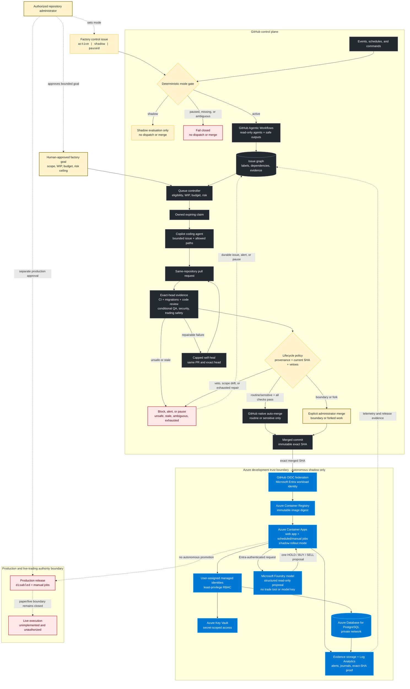

# Agentic software factory

Project Krypto runs a safety-bounded, event-driven GitHub factory. The normative contract is [`specs/factory.md`](../specs/factory.md); machine policy is [`.github/agentic-policy.json`](../.github/agentic-policy.json).

## End-to-end dark factory

**Diagram conventions:** solid arrows are automated transitions; dashed arrows
are human authority, feedback, or intentionally blocked promotion paths. The
GitHub and Azure subgraphs are separate trust boundaries. Every merge decision
uses current-head evidence, and every Azure deployment is bound to the exact
merged SHA and immutable image digest.

The design follows GitHub and Azure operational guidance:

- use issues, labels, protected checks, and native auto-merge as durable GitHub
  state rather than hidden agent memory;
- keep agents read-only and perform mutations only through permission-scoped
  safe outputs and deterministic controllers;
- use OIDC federation, Entra workload identities, managed identities, and
  least-privilege RBAC instead of long-lived cloud credentials;
- separate control and data planes, development and production boundaries, and
  runtime, scheduler, and operator identities;
- deploy immutable artifacts, keep PostgreSQL private, centralize secrets in
  Key Vault, and send evidence and alerts to durable observability stores;
- fail closed on missing authority, stale evidence, ambiguous risk, human
  vetoes, exhausted repair budgets, or any attempt to cross production/live
  boundaries.

- Humans approve goals, boundary merges, production/live actions, secrets/accounts, and architecture.
- Automation may triage, plan, implement, review, repair within caps, natively auto-merge eligible routine/sensitive PRs, and deploy the exact merged SHA to development/shadow.
- Missing authority, ambiguous risk/scope, stale checks, human veto, exhausted repair, or safety impact fails closed.
- Labels are lifecycle state; claims are owned expiring leases; all merge evidence must match the current head.
- See [`agentic-workflows-map.md`](./agentic-workflows-map.md) for the generated workflow inventory.
