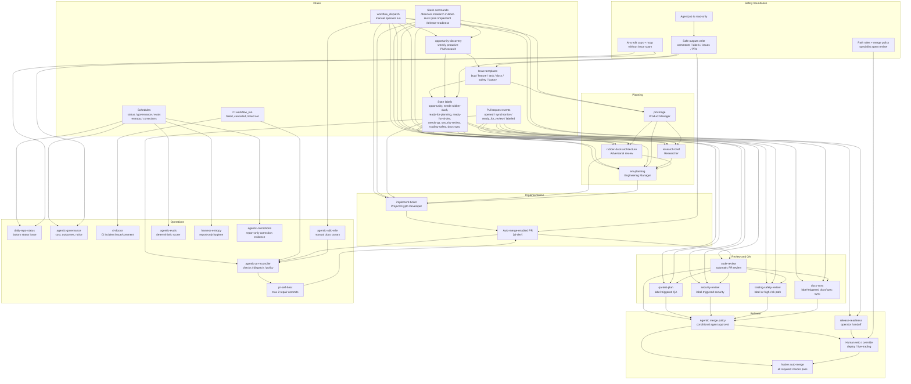

# Agentic Workflows Map

Project Krypto's software factory is a GitHub Agentic Workflows (GH-AW) system that turns proactive opportunity discovery, issues, labels, slash commands, pull requests, CI events, and schedules into a controlled SDLC loop.

The GH-AW workflows are intentionally event-driven: each has a narrow job,
read-only agent permissions, and safe outputs for repository writes. The
deterministic reconciler and E2E canary are traditional Actions workflows with
their own explicitly scoped permissions.

## End-to-end flow

## How GH-AW runs in this repo

1. Workflow source files live in `.github/workflows/*.md`.
2. `gh aw compile` generates `.github/workflows/*.lock.yml`.
3. GitHub Actions runs the compiled `.lock.yml` files.
4. The agent job reads repository context with scoped read permissions.
5. The agent requests visible changes through safe outputs.
6. Separate safe-output jobs apply those changes with narrowly scoped write permissions.

This is why workflow markdown is the source of truth, while lock files are committed generated artifacts for transparency.

`agentic-pr-reconciler.yml` is intentionally a traditional deterministic Actions workflow: it performs policy checks and dispatch only, loads its tested implementation from the trusted default branch, and never executes pull-request code. `agentic-sdlc-e2e.yml` is a second traditional workflow; it is manual-only and creates a constrained same-repository docs canary to verify the complete native auto-merge path. `agentic-evals.yml` is a third traditional workflow; it runs the deterministic, read-only agentic SDLC evaluation on a manual/weekly schedule, uploads a report artifact, and makes no live-model call.

## SDLC lifecycle

| Stage | Main trigger | Workflow | Role | Output |
|---|---|---|---|---|
| Opportunity discovery | Weekly schedule, `/discover`, manual | `opportunity-discovery` | Trading Growth PM | At most one `[opportunity]` ticket behind rubber-duck review |
| Intake | New/reopened/labeled issue | `pm-triage` | Product Manager | Triage comment, labels, follow-up issues |
| Research | `/research`, `ai:research`, manual | `research-brief` | Researcher | Research comment or research follow-up issues |
| Challenge | `/rubber-duck`, `needs-rubber-duck`, manual | `rubber-duck-architecture` | Rubber Duck | `approve`, `revise`, or `block` review comment and next labels |
| Planning | `/plan`, `ready-for-planning`, manual | `em-planning` | Engineering Manager | Plan comment, grouped child issues, next labels |
| Implementation | `/implement`, `ready-for-ai-dev`, manual | `implement-ticket` | Project Krypto Developer | Auto-merge-enabled PR or blocked issue/comment |
| PR review | PR opened/sync/reopened/ready | `code-review` | Code Reviewer | PR comment, specialist labels, follow-up issues |
| QA | `needs-qa`, manual | `qa-test-plan` | QA Engineer | Test plan comment or QA gap issues |
| Security | `security-review`, manual | `security-review` | Security Reviewer | Security review comment or follow-up issues |
| Trading safety | `trading-safety`, high-risk PR paths, manual | `trading-safety-review` | Trading Safety Reviewer | Safety review comment, labels, follow-up issues |
| Docs/spec sync | `docs-sync`, manual | `docs-sync` | Docs/Spec Writer | Docs PR, comment, or docs-gap issues |
| Release | `/release-readiness`, `release-readiness`, manual | `release-readiness` | Release Manager | Release checklist comment or blocker issues |
| CI incident | Failed/cancelled/timed-out `CI` workflow run | `ci-doctor` | CI Doctor | Incident issue/comment |
| PR reconciliation | PR/review/workflow events, 5-minute schedule | `agentic-pr-reconciler` | Deterministic Actions gate | Dispatch missing checks, publish merge policy, cap repair attempts |
| PR self-heal | Reconciler dispatch after a failed required check | `pr-self-heal` | Project Krypto Developer | One focused repair commit or blocked handoff |
| Factory E2E | Manual `happy-path` or `self-heal` dispatch | `agentic-sdlc-e2e` | Deterministic Actions canary | Required-context, repair, native auto-merge, and cleanup evidence |
| SDLC evaluation | Manual/weekly schedule | `agentic-evals` | Deterministic Actions scorer | Read-only eval report artifact; no live-model call |
| Factory entropy | Manual/weekly schedule | `harness-entropy` | Entropy Reporter | One report-only issue or noop; no fix authority |
| Correction evidence | Manual/weekly schedule | `agentic-corrections` | Correction Reporter | Trusted-human label correction metrics or noop |
| Status | Daily schedule/manual | `daily-repo-status` | Repo Status Reporter | Daily factory status issue |
| Governance | Weekly schedule/manual | `agentic-governance` | Governance Reporter | Cost/outcome/noise report issue |

## Trigger catalog

| Trigger | Activates | Notes |
|---|---|---|
| Weekly schedule | `opportunity-discovery` | Proactively creates at most one high-quality opportunity ticket behind rubber-duck review. |
| `/discover` | `opportunity-discovery` | Centralized slash command for human PM steering. |
| `opportunity` label | downstream review flow | Marks proactive opportunity tickets; rubber-duck decides whether to advance them to planning. |
| New/reopened issue | `pm-triage` | Product triage is the default intake path. |
| Any labeled issue | `pm-triage` | Lets PM refine state transitions after labels change. |
| `ai:research` label | `research-brief` | Requests evidence-backed research. |
| `needs-rubber-duck` label | `rubber-duck-architecture` | Runs adversarial review on issue or PR. |
| `ready-for-planning` label | `em-planning` | Breaks work into implementation-ready tickets. |
| `ready-for-ai-dev` label | `implement-ticket` | Opens an auto-merge-enabled implementation PR when ready. |
| `needs-qa` label | `qa-test-plan` | Runs QA/test-gap review on issue or PR. |
| `security-review` label | `security-review` | Runs security review on issue or PR. |
| `trading-safety` issue label | `trading-safety-review` | Runs trading/guardrail safety review for an issue. |
| `docs-sync` label | `docs-sync` | Runs docs/spec alignment review or docs PR. |
| `release-readiness` label | `release-readiness` | Produces release checklist for a PR. |
| `/research` | `research-brief` | Centralized slash command for issues/comments. |
| `/rubber-duck` | `rubber-duck-architecture` | Centralized slash command for issues/PRs/comments. |
| `/plan` | `em-planning` | Centralized slash command for issues/comments. |
| `/implement` | `implement-ticket` | Centralized slash command for issues/comments. |
| `/release-readiness` | `release-readiness` | Centralized slash command for issues/PRs/comments. |
| PR opened/synchronize/reopened/ready | `code-review` | Lightweight automatic review; can add specialist labels. |
| PR high-risk paths | `trading-safety-review` | Automatic for `src/trading/**`, `src/tools/**`, `src/guardrails/**`, `src/agent/**`, `src/backtest/**`, `src/app/api/agent/**`, `src/db/**`, `drizzle/**`, `supabase/migrations/**`, and `specs/rfcs/**`. PR label events are still path-scoped. |
| CI workflow failure | `ci-doctor` | Watches `CI` on `main` and `develop/**`. |
| PR/check/review event or 5-minute schedule | `agentic-pr-reconciler` | Restores missed CI/review dispatches, publishes merge policy, and dispatches bounded repair. |
| Manual factory E2E | `agentic-sdlc-e2e` | Updates one stable docs heartbeat through the happy path or deterministic self-heal path; never runs on a schedule or PR event. |
| Manual/weekly schedule | `agentic-evals` | Runs deterministic SDLC safety/contract fixtures and uploads an artifact; no model call. |
| Manual/weekly schedule | `harness-entropy` | Reports material harness entropy without fix authority. |
| Manual/weekly schedule | `agentic-corrections` | Reports PM-triage and specialist-label corrections from trusted-human label events. |
| Daily schedule | `daily-repo-status` | Creates or replaces daily factory status issue. |
| Weekly schedule | `agentic-governance` | Reports workflow health, cost, outcomes, and noise. |

## Centralized slash-command routing

The workflows that support slash commands use centralized routing. GitHub events first hit `.github/workflows/agentic_commands.yml`, which detects supported commands and dispatches the target workflow.

Supported commands:

| Command | Target workflow |
|---|---|
| `/discover` | `opportunity-discovery` |
| `/research` | `research-brief` |
| `/rubber-duck` | `rubber-duck-architecture` |
| `/plan` | `em-planning` |
| `/implement` | `implement-ticket` |
| `/release-readiness` | `release-readiness` |

QA and docs-sync intentionally do not have slash commands. They are label-triggered to avoid expensive or noisy PR fanout.

## Workflow catalog

The table below is generated from GH-AW source frontmatter. It covers the
agent workflows compiled from `.github/workflows/*.md`. The three traditional
deterministic Actions workflows — `agentic-pr-reconciler`, `agentic-sdlc-e2e`,
and `agentic-evals` — are not GH-AW sources; their behavior is described in the
SDLC lifecycle and safety sections above and below. `agentic-evals` runs the
deterministic agentic SDLC evaluation (see
[`../specs/agentic-sdlc-evaluation.md`](../specs/agentic-sdlc-evaluation.md))
on a manual/weekly schedule with read-only permissions and no live-model call.

<!-- generated:workflow-inventory:start -->

_Generated from `.github/workflows/*.md` frontmatter by `scripts/generate-agentic-docs.ts`. Do not edit by hand; run `npm run agentic:docs` after changing a workflow source._

| Workflow | Import | Primary triggers | Safe outputs | AI credits (run / day) |
|---|---|---|---|---|
| `agentic-corrections` | `Built-in prompt` | manual; schedule: weekly on monday | `create-issue`, `noop` | 1000 / 2500 |
| `agentic-governance` | `Built-in prompt` | manual; schedule: weekly on monday | `create-issue`, `noop` | 1000 / 2500 |
| `ci-doctor` | `Built-in prompt` | manual; workflow_run: CI | `add-comment`, `create-issue`, `noop` | 1200 / 3000 |
| `code-review` | `Built-in prompt` | manual; PR: opened, ready_for_review, reopened, synchronize | `add-comment`, `add-labels`, `create-check-run`, `create-issue`, `noop` | 1500 / 5000 |
| `daily-repo-status` | `Built-in prompt` | manual; schedule: daily | `create-issue`, `noop` | 1000 / 2500 |
| `docs-sync` | `docs-spec-writer.md` | manual; issue label: docs-sync; PR: labeled | `add-comment`, `create-issue`, `create-pull-request`, `noop` | 1400 / 3000 |
| `em-planning` | `engineering-manager.md` | manual; /plan; issue label: ready-for-planning | `add-comment`, `add-labels`, `create-issue`, `noop` | 1200 / 3000 |
| `harness-entropy` | `Built-in prompt` | manual; schedule: weekly on monday | `create-issue`, `noop` | 1000 / 2500 |
| `implement-ticket` | `project-krypto-dev.md` | manual; /implement; issue label: ready-for-ai-dev | `add-comment`, `create-issue`, `create-pull-request`, `noop` | 2500 / 5000 |
| `opportunity-discovery` | `trading-growth-pm.md` | manual; schedule: weekly; /discover | `add-comment`, `create-issue`, `noop` | 1000 / 2000 |
| `pm-triage` | `product-manager.md` | manual; issue: labeled, opened, reopened | `add-comment`, `add-labels`, `create-issue`, `noop` | 1000 / 3000 |
| `pr-self-heal` | `project-krypto-dev.md` | manual | `add-comment`, `add-labels`, `noop`, `push-to-pull-request-branch` | 2200 / 5000 |
| `qa-test-plan` | `qa-engineer.md` | manual; issue label: needs-qa; PR: labeled | `add-comment`, `create-issue`, `noop` | 1600 / 3500 |
| `release-readiness` | `release-manager.md` | manual; /release-readiness; PR: labeled | `add-comment`, `create-issue`, `noop` | 1200 / 3000 |
| `research-brief` | `researcher.md` | manual; /research; issue label: ai:research | `add-comment`, `create-issue`, `noop` | 1500 / 4000 |
| `rubber-duck-architecture` | `rubber-duck.md` | manual; /rubber-duck; issue label: needs-rubber-duck; PR: labeled | `add-comment`, `add-labels`, `noop` | 1200 / 3000 |
| `security-review` | `security-reviewer.md` | manual; issue label: security-review; PR: labeled | `add-comment`, `create-check-run`, `create-issue`, `noop` | 1500 / 3500 |
| `trading-safety-review` | `trading-safety-reviewer.md` | manual; issue label: trading-safety; PR: labeled, opened, reopened, synchronize (path-scoped) | `add-comment`, `add-labels`, `create-check-run`, `create-issue`, `noop` | 1600 / 4000 |

<!-- generated:workflow-inventory:end -->

## Label state model

Labels are workflow state transitions:

| Label | Meaning |
|---|---|
| `opportunity` | Proactive PM/research opportunity ticket; starts behind rubber-duck review. |
| `profit-hypothesis` | Hypothesis intended to improve risk-adjusted paper-trading performance. |
| `experiment` | Experiment or measurement-oriented implementation ticket. |
| `strategy-research` | Trading strategy or market research needed before implementation. |
| `needs-triage` | Needs PM refinement. |
| `ai:research` | Needs researcher workflow. |
| `needs-rubber-duck` | Needs adversarial approach review. |
| `ready-for-planning` | Ready for EM planning. |
| `ready-for-ai-dev` | Ready for auto-merge-enabled PR implementation. |
| `needs-ai-review` | Needs automated review or follow-up review state. |
| `needs-qa` | Needs QA/test-gap review. |
| `security-review` | Needs security review. |
| `trading-safety` | Needs trading/guardrail safety review; directly triggers issue review and marks PRs for attention alongside high-risk path triggers. |
| `docs-sync` | Needs docs/spec alignment. |
| `release-readiness` | Needs release handoff/checklist. |
| `ready-for-human-review` | Automation is done; a human should review. |
| `blocked` | Automation or implementation cannot proceed safely. |
| `agentic-automerge` | Agent PR is enrolled in reconciliation and native auto-merge. |
| `self-heal-exhausted` | Repair stopped after two failed self-heal commits. |

## Safety and governance model

The factory is designed to automate work without letting the agent directly mutate the repository.

- **Read-only agent jobs:** workflow `permissions` keep the agent job read-scoped.
- **Safe outputs:** comments, labels, issues, and PRs are applied by separate safe-output jobs.
- **Native auto-merge:** implementation/docs PRs enroll in auto-merge, while every same-repository PR requires CI, current-head code review, conversation resolution, and the deterministic merge-policy status.
- **Conditional agent approval:** auth/dependency/deployment/workflow paths require `Security review`; trading/guardrail/agent/backtest/database/migration/RFC paths require `Trading safety review`.
- **Bounded self-heal:** failed eligible low-risk docs PRs receive at most two focused repair commits before being blocked; production code, tests, migrations, specs, workflows, and sensitive documentation are excluded structurally.
- **Allowed files:** implementation PRs are constrained to app, tests, scripts, schema/migrations, specs, and config files that are safe for the workflow to touch.
- **Protected files:** protected file changes fall back to issues instead of being silently committed.
- **Specialist reviews:** security and trading-safety checks are selected deterministically from changed paths; QA and docs remain label-driven.
- **High-risk paths:** trading-safety review runs for trading, agent, guardrail, backtest, DB, migration, and RFC paths.
- **Human control:** a current-head change request or blocking label vetoes agent approval; humans retain deployment, live-trading, secret, and architecture-decision authority.
- **Opportunity discovery:** creates software tickets and experiments behind rubber-duck review; it does not provide trading advice, execute trades, or bypass safety review.
- **Cost/noise controls:** workflows use `max-ai-credits`, `max-daily-ai-credits`, deduplication where appropriate, and `noop.report-as-issue: false`.

Required repository configuration: native auto-merge enabled; strict required checks for both CI jobs, `Agentic code review`, and `Agentic merge policy`; zero unconditional approving reviews; required conversation resolution and admin enforcement enabled; force pushes and protected-branch deletion disabled. Conditional security and trading-safety checks are enforced through `Agentic merge policy`.

GitHub Actions must be allowed to create pull requests while default workflow permissions remain read-only. For trusted enrolled same-repository agent PRs, held CI runs are approved and held agentic-review runs are replaced by a PR-head manual review dispatch; neither condition is treated as a code failure or sent to self-heal.

## Typical paths

### Feature or bug

1. User opens a bug/feature/task issue.
2. `pm-triage` refines it and labels the next state.
3. Optional `research-brief` or `rubber-duck-architecture` runs.
4. `em-planning` decomposes larger work.
5. `implement-ticket` opens an auto-merge-enabled PR.
6. `code-review` reviews the PR automatically.
7. Deterministic path rules trigger security/trading-safety checks; labels trigger QA/docs review as needed.
8. The reconciler dispatches missing checks and bounded self-heal when needed.
9. Same-repository changes merge when all required agent checks pass; forks still require human approval.

### Proactive opportunity

1. `opportunity-discovery` runs weekly or when a human uses `/discover`.
2. It creates at most one `[opportunity]` issue with `needs-rubber-duck`.
3. `rubber-duck-architecture` decides whether to advance each ticket to planning or block/revise it.
4. `pm-triage` and `em-planning` refine approved tickets.
5. Low-risk work may continue to implementation; trading or risk-sensitive work must pass trading-safety review first.

### High-risk trading change

1. PR touches an automatic trading-safety path: `src/trading/**`,
   `src/tools/**`, `src/guardrails/**`, `src/agent/**`, `src/backtest/**`,
   `src/app/api/agent/**`, `src/db/**`, `drizzle/**`,
   `supabase/migrations/**`, or `specs/rfcs/**`.
2. `trading-safety-review` runs automatically.
3. It classifies the change as safe, safe-with-required-fixes, or unsafe.
4. The required merge-policy status stays pending until the current-head trading-safety check is `safe`.

### CI failure

1. `CI` completes with failure, cancellation, timeout, or action-required on `main` or `develop/**`.
2. `ci-doctor` inspects the failure.
3. It creates a deduplicated incident issue, comments on an existing target, or noops for duplicate/self-recovered failures.

### Agent PR check failure

1. The reconciler observes failed CI or an `Agentic code review` failure on an enrolled agent PR.
2. `pr-self-heal` inspects the evidence and may push one focused repair commit.
3. CI and review rerun on the new head.
4. After two repair commits, or one no-change repair run, the PR is labeled `self-heal-exhausted` and `blocked`.

### Manual factory E2E

1. An operator dispatches `agentic-sdlc-e2e.yml` from `main` in
   `happy-path` or `self-heal` mode.
2. The workflow creates an enrolled `github-actions[bot]` PR that changes only
   `docs/e2e/factory-heartbeat.md` and invokes the reconciler.
3. It requires successful `Quality and evidence gates`,
   `PostgreSQL migrations and execution`, `Agentic code review`, and
   `Agentic merge policy` contexts on the current head.
4. After observing a fully settled head, it holds merge policy pending, enables
   native auto-merge, and lets the reconciler restore success. Self-heal mode
   additionally requires an initial review failure, a
   `[self-heal]` commit, and removal of the deterministic marker.
5. Only after those assertions and the full check suite settle does the E2E
   workflow place a temporary pending merge-policy hold and enable native
   auto-merge; the reconciler must restore the passing policy status.
6. Success leaves one updated heartbeat on `main`; cleanup deletes the branch,
   and failure also closes any open canary PR.

### Operational reporting (MonitorOps)

Both scheduled reporters run the same deterministic, dependency-free collector
(`scripts/agentic/collect-factory-health.cjs`) as their first step, then only
summarize its normalized JSON snapshot. The collector:

- inventories every `.github/workflows/*.md` GH-AW source (plus the `agentic-evals`
  and `ci` Actions workflows) over an explicit closed UTC window — the last 24
  full hours for `daily`, the last 7 full days for `governance`;
- represents every active workflow, including zero-run workflows, and serializes
  unavailable cost/token/safe-output/correction telemetry as `null`, never `0`;
- computes a material-state hash and evaluates configured thresholds (repeated
  failure, WIP over cap, eval/harness failure, per-run AI-credit cap, telemetry
  missing across two published periods, and source/lock drift);
- treats the `<!-- factory-state-hash: ... -->` marker embedded in prior report
  issues as the authoritative published state, so a `cache-memory` miss never
  suppresses the next report.

`cache-memory` (90-day retention) stores only snapshots and watermarks. The
reporters are read-only toward GitHub, expose only the trusted collector and
snapshot reader on their bash allowlist, and publish a single recurring issue with
`close-older-issues`, `expires`, no @mentions, and no GitHub backlinks:

1. `daily-repo-status` reports concise existing-work changes (throughput, aging,
   blocked work, PR state) and never creates new feature scope.
2. `agentic-governance` reports full factory health, cost, and threshold
   breaches.
3. Each embeds the state-hash marker and calls `noop` when the material state is
   unchanged, so an idle week produces no issue.

### Report-only entropy (harness-entropy)

`harness-entropy` is a weekly (plus `workflow_dispatch`) **report-only** scan of
the factory's governance surfaces. It never invents or applies a code, policy,
instruction, or trading change — it may quote deterministic remediation for a
risky path but must not modify it or suggest bypassing review. Two deterministic,
dependency-free collectors run
before the agent summarizes anything:

1. the MonitorOps collector (governance mode) writes
   `/tmp/gh-aw/factory-health.json`;
2. `scripts/agentic/collect-agentic-entropy.cjs` consumes that snapshot and emits
   a versioned JSON manifest (`/tmp/gh-aw/entropy-manifest.json`).

The manifest reuses existing authorities rather than duplicating logic — the
canonical policy loader, the MonitorOps workflow inventory, and the supplied
MonitorOps snapshot (WIP, telemetry, repeated failures are read from the snapshot,
never re-queried from GitHub). It reports across explicit **dimensions** — policy
consistency, source/lock consistency, instruction/reference integrity,
architecture integrity, observability coverage, backlog hygiene, and
maintainability hotspots — with per-rule evidence and **no vanity aggregate
score**. Each violation carries its exact owning `path` and a `remediation`.

Rules split into two severities:

- **Zero-tolerance** (also enforced locally by `npm run entropy:check`, wired into
  `harness:check`): canonical policy valid, every active GH-AW source compiled
  with required generated support files, local instruction/doc references resolve,
  workflow imports exist, no prohibited live executor, and generated doc markers
  present.
- **Advisory** (report-only, never blocks CI): duplicated policy literals, stale
  actionable-opportunity WIP vs the policy cap, workflow telemetry coverage and
  repeated failures, architecture boundary hotspots, source files over the
  documented advisory line threshold (500), and TODO/FIXME/HACK markers. Backlog
  and telemetry rules report `unknown` when no MonitorOps snapshot is supplied,
  never a false zero.

The workflow exposes only the two trusted node collectors and `cat` on its bash
allowlist, a single `create-issue` safe output (max 1, `close-older-issues`,
90-day `expires`, no @mentions, no backlinks) plus `noop`, and `cache-memory`
with 90-day retention. It publishes at most one recurring `[factory-entropy]`
issue and embeds an `<!-- entropy-state-hash: ... -->` marker; the published
issue history is authoritative over cache, so a cache miss never suppresses a
report. It calls `noop` when there is no material delta and no actionable
violation.

### Staged CorrectionOps (agentic-corrections)

`agentic-corrections` is a weekly (plus `workflow_dispatch`) **staged,
report-only** loop that measures how often the factory's PM-triage and
specialist-routing label decisions were later corrected by a trusted human. It
improves measurement only — it never proposes or applies a code, policy,
instruction, label, or trading change. One deterministic, dependency-free
collector (`scripts/agentic/collect-agentic-corrections.cjs`) runs before the
agent summarizes anything and writes `/tmp/gh-aw/correction-report.json`.

Predictions are reconstructed from the real `gh aw logs --artifacts all` artifact
shape (`aw_info.json`, `safeoutputs.jsonl`,
`safe-outputs-items/safe-output-items.jsonl`, and the
`aw-prompts/prompt-import-tree.json` + `prompt.txt` instruction fingerprint), not
from model-authored markers:

- **PM triage** — requested `add-labels`/`noop` and the target issue;
- **Specialist routing** — requested `add-labels` limited to
  `security-review`/`trading-safety` as *semantic* routes, kept separate from the
  *immutable* routes derived from the PR's changed paths via the canonical
  reconciler (`.github/scripts/agentic-pr-reconciler.cjs`).

Trusted truth comes only from later GitHub label events authored by a
`User` collaborator with `admin`/`maintain`/`write` permission after the
prediction was applied; bots and untrusted users are provenance-only and never
scored, and a record with no trusted human action is `pending`, never a `match`.
A human removing a predicted specialist label is a semantic correction but never
weakens an immutable route — that is surfaced as a `> [!WARNING]` safety conflict.
The versioned report tracks match/mismatch/pending, correction rate (or `null` at
sample size `0`), immutable-route conflicts, and
instruction/workflow/model groupings, and stores no raw
issue/comment/prompt/event body.

The workflow exposes only the trusted node collector and `cat` on its bash
allowlist, read-only permissions, a single `create-issue` safe output (max 1,
`close-older-issues`, 90-day `expires`, no @mentions, no backlinks) plus `noop`,
and `cache-memory` with 90-day retention. It publishes at most one recurring
`[factory-corrections]` issue and embeds an
`<!-- correction-state-hash: ... -->` marker; the published issue history is
authoritative over cache, so a cache miss re-baselines without a false correction.
It calls `noop` when there is no new trusted correction evidence or no material
delta. A deterministic `npm run corrections:check` validates the diff engine
against committed contract fixtures and never contacts GitHub. It never scores or
learns around trading authorization, guardrails, leases, reconciliation, operator
pause, or the paper/live boundary.
