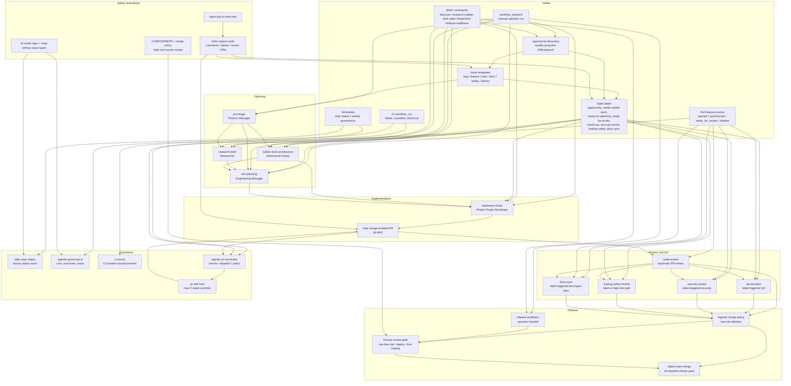

# Agentic Workflows Map

Project Krypto's software factory is a GitHub Agentic Workflows (GH-AW) system that turns proactive opportunity discovery, issues, labels, slash commands, pull requests, CI events, and schedules into a controlled SDLC loop.

The factory is intentionally event-driven: each workflow has a narrow job, read-only agent permissions, and safe outputs for all repository writes.

## End-to-end flow

## How GH-AW runs in this repo

1. Workflow source files live in `.github/workflows/*.md`.
2. `gh aw compile` generates `.github/workflows/*.lock.yml`.
3. GitHub Actions runs the compiled `.lock.yml` files.
4. The agent job reads repository context with scoped read permissions.
5. The agent requests visible changes through safe outputs.
6. Separate safe-output jobs apply those changes with narrowly scoped write permissions.

This is why workflow markdown is the source of truth, while lock files are committed generated artifacts for transparency.

`agentic-pr-reconciler.yml` is intentionally a traditional deterministic Actions workflow: it performs policy checks and dispatch only, and never executes pull-request code.

## SDLC lifecycle

| Stage | Main trigger | Workflow | Role | Output |
|---|---|---|---|---|
| Opportunity discovery | Weekly schedule, `/discover`, manual | `opportunity-discovery` | Trading Growth PM | At most one `[opportunity]` ticket behind rubber-duck review |
| Intake | New/reopened/labeled issue | `pm-triage` | Product Manager | Triage comment, labels, follow-up issues |
| Research | `/research`, `ai:research`, manual | `research-brief` | Researcher | Research comment or research follow-up issues |
| Challenge | `/rubber-duck`, `needs-rubber-duck`, manual | `rubber-duck-architecture` | Rubber Duck | `approve`, `revise`, or `block` review comment and next labels |
| Planning | `/plan`, `ready-for-planning`, manual | `em-planning` | Engineering Manager | Plan comment, grouped child issues, next labels |
| Implementation | `/implement`, `ready-for-ai-dev`, manual | `implement-ticket` | Project Krypto Developer | Auto-merge-enabled PR or blocked issue/comment |
| PR review | PR opened/sync/reopened/ready | `code-review` | Code Reviewer | PR comment, specialist labels, follow-up issues |
| QA | `needs-qa`, manual | `qa-test-plan` | QA Engineer | Test plan comment or QA gap issues |
| Security | `security-review`, manual | `security-review` | Security Reviewer | Security review comment or follow-up issues |
| Trading safety | `trading-safety`, high-risk PR paths, manual | `trading-safety-review` | Trading Safety Reviewer | Safety review comment, labels, follow-up issues |
| Docs/spec sync | `docs-sync`, manual | `docs-sync` | Docs/Spec Writer | Docs PR, comment, or docs-gap issues |
| Release | `/release-readiness`, `release-readiness`, manual | `release-readiness` | Release Manager | Release checklist comment or blocker issues |
| CI incident | Failed/cancelled/timed-out `CI` workflow run | `ci-doctor` | CI Doctor | Incident issue/comment |
| PR reconciliation | PR/review/workflow events, 5-minute schedule | `agentic-pr-reconciler` | Deterministic Actions gate | Dispatch missing checks, publish merge policy, cap repair attempts |
| PR self-heal | Reconciler dispatch after a failed required check | `pr-self-heal` | Project Krypto Developer | One focused repair commit or blocked handoff |
| Status | Daily schedule/manual | `daily-repo-status` | Repo Status Reporter | Daily factory status issue |
| Governance | Weekly schedule/manual | `agentic-governance` | Governance Reporter | Cost/outcome/noise report issue |

## Trigger catalog

| Trigger | Activates | Notes |
|---|---|---|
| Weekly schedule | `opportunity-discovery` | Proactively creates at most one high-quality opportunity ticket behind rubber-duck review. |
| `/discover` | `opportunity-discovery` | Centralized slash command for human PM steering. |
| `opportunity` label | downstream review flow | Marks proactive opportunity tickets; rubber-duck decides whether to advance them to planning. |
| New/reopened issue | `pm-triage` | Product triage is the default intake path. |
| Any labeled issue | `pm-triage` | Lets PM refine state transitions after labels change. |
| `ai:research` label | `research-brief` | Requests evidence-backed research. |
| `needs-rubber-duck` label | `rubber-duck-architecture` | Runs adversarial review on issue or PR. |
| `ready-for-planning` label | `em-planning` | Breaks work into implementation-ready tickets. |
| `ready-for-ai-dev` label | `implement-ticket` | Opens an auto-merge-enabled implementation PR when ready. |
| `needs-qa` label | `qa-test-plan` | Runs QA/test-gap review on issue or PR. |
| `security-review` label | `security-review` | Runs security review on issue or PR. |
| `trading-safety` issue label | `trading-safety-review` | Runs trading/guardrail safety review for an issue. |
| `docs-sync` label | `docs-sync` | Runs docs/spec alignment review or docs PR. |
| `release-readiness` label | `release-readiness` | Produces release checklist for a PR. |
| `/research` | `research-brief` | Centralized slash command for issues/comments. |
| `/rubber-duck` | `rubber-duck-architecture` | Centralized slash command for issues/PRs/comments. |
| `/plan` | `em-planning` | Centralized slash command for issues/comments. |
| `/implement` | `implement-ticket` | Centralized slash command for issues/comments. |
| `/release-readiness` | `release-readiness` | Centralized slash command for issues/PRs/comments. |
| PR opened/synchronize/reopened/ready | `code-review` | Lightweight automatic review; can add specialist labels. |
| PR high-risk paths | `trading-safety-review` | Automatic for agent, guardrail, DB, migration, and RFC paths. PR label events are still path-scoped. |
| CI workflow failure | `ci-doctor` | Watches `CI` on `main` and `develop/**`. |
| PR/check/review event or 5-minute schedule | `agentic-pr-reconciler` | Restores missed CI/review dispatches, publishes merge policy, and dispatches bounded repair. |
| Daily schedule | `daily-repo-status` | Creates or replaces daily factory status issue. |
| Weekly schedule | `agentic-governance` | Reports workflow health, cost, outcomes, and noise. |

## Centralized slash-command routing

The workflows that support slash commands use centralized routing. GitHub events first hit `.github/workflows/agentic_commands.yml`, which detects supported commands and dispatches the target workflow.

Supported commands:

| Command | Target workflow |
|---|---|
| `/discover` | `opportunity-discovery` |
| `/research` | `research-brief` |
| `/rubber-duck` | `rubber-duck-architecture` |
| `/plan` | `em-planning` |
| `/implement` | `implement-ticket` |
| `/release-readiness` | `release-readiness` |

QA and docs-sync intentionally do not have slash commands. They are label-triggered to avoid expensive or noisy PR fanout.

## Workflow catalog

| Workflow | Agent/import | Primary triggers | Safe outputs |
|---|---|---|---|
| `opportunity-discovery` | `trading-growth-pm.md` | `schedule: weekly`, `/discover`, manual | `create-issue`, `add-comment`, `noop` |
| `daily-repo-status` | Built-in prompt | `schedule: daily`, manual | `create-issue`, `noop` |
| `research-brief` | `researcher.md` | `/research`, `ai:research`, manual | `add-comment`, `create-issue`, `noop` |
| `pm-triage` | `product-manager.md` | Issue opened/reopened/labeled, manual | `add-comment`, `add-labels`, `create-issue`, `noop` |
| `rubber-duck-architecture` | `rubber-duck.md` | `/rubber-duck`, `needs-rubber-duck`, manual | `add-comment`, `add-labels`, `noop` |
| `em-planning` | `engineering-manager.md` | `/plan`, `ready-for-planning`, manual | `add-comment`, `create-issue`, `add-labels`, `noop` |
| `implement-ticket` | `project-krypto-dev.md` | `/implement`, `ready-for-ai-dev`, manual | `create-pull-request`, `create-issue`, `add-comment`, `noop` |
| `code-review` | Built-in prompt | PR opened/sync/reopened/ready, manual | `create-check-run`, `add-comment`, `add-labels`, `create-issue`, `noop` |
| `qa-test-plan` | `qa-engineer.md` | `needs-qa`, manual | `add-comment`, `create-issue`, `noop` |
| `security-review` | `security-reviewer.md` | `security-review`, manual | `add-comment`, `create-issue`, `noop` |
| `trading-safety-review` | `trading-safety-reviewer.md` | `trading-safety` issue label, high-risk PR paths, manual | `add-comment`, `add-labels`, `create-issue`, `noop` |
| `docs-sync` | `docs-spec-writer.md` | `docs-sync`, manual | `add-comment`, `create-pull-request`, `create-issue`, `noop` |
| `ci-doctor` | Built-in prompt | Failed `CI` workflow run, manual | `create-issue`, `add-comment`, `noop` |
| `release-readiness` | `release-manager.md` | `/release-readiness`, `release-readiness`, manual | `add-comment`, `create-issue`, `noop` |
| `agentic-governance` | Built-in prompt | `schedule: weekly on monday`, manual | `create-issue`, `noop` |
| `pr-self-heal` | `project-krypto-dev.md` | Reconciler `workflow_dispatch` | `push-to-pull-request-branch`, `add-comment`, `add-labels`, `noop` |
| `agentic-pr-reconciler` | Deterministic GitHub Script | PR/review/workflow events, 5-minute schedule | Commit status, workflow dispatch, exhausted-repair labels |

## Label state model

Labels are workflow state transitions:

| Label | Meaning |
|---|---|
| `opportunity` | Proactive PM/research opportunity ticket; starts behind rubber-duck review. |
| `profit-hypothesis` | Hypothesis intended to improve risk-adjusted paper-trading performance. |
| `experiment` | Experiment or measurement-oriented implementation ticket. |
| `strategy-research` | Trading strategy or market research needed before implementation. |
| `needs-triage` | Needs PM refinement. |
| `ai:research` | Needs researcher workflow. |
| `needs-rubber-duck` | Needs adversarial approach review. |
| `ready-for-planning` | Ready for EM planning. |
| `ready-for-ai-dev` | Ready for auto-merge-enabled PR implementation. |
| `needs-ai-review` | Needs automated review or follow-up review state. |
| `needs-qa` | Needs QA/test-gap review. |
| `security-review` | Needs security review. |
| `trading-safety` | Needs trading/guardrail safety review; directly triggers issue review and marks PRs for attention alongside high-risk path triggers. |
| `docs-sync` | Needs docs/spec alignment. |
| `release-readiness` | Needs release handoff/checklist. |
| `ready-for-human-review` | Automation is done; a human should review. |
| `blocked` | Automation or implementation cannot proceed safely. |
| `agentic-automerge` | Agent PR is enrolled in reconciliation and native auto-merge. |
| `self-heal-exhausted` | Repair stopped after two failed self-heal commits. |

## Safety and governance model

The factory is designed to automate work without letting the agent directly mutate the repository.

- **Read-only agent jobs:** workflow `permissions` keep the agent job read-scoped.
- **Safe outputs:** comments, labels, issues, and PRs are applied by separate safe-output jobs.
- **Native auto-merge:** implementation/docs PRs enroll in auto-merge, but branch protection still requires CI, agentic review, conversation resolution, and the deterministic merge-policy status.
- **Autonomous low-risk boundary:** only non-sensitive docs and static image assets can pass merge policy without a current human approval.
- **Bounded self-heal:** failed eligible low-risk docs PRs receive at most two focused repair commits before being blocked; production code, tests, migrations, specs, workflows, and sensitive documentation are excluded structurally.
- **Allowed files:** implementation PRs are constrained to app, tests, scripts, schema/migrations, specs, and config files that are safe for the workflow to touch.
- **Protected files:** protected file changes fall back to issues instead of being silently committed.
- **Specialist reviews:** QA, security, docs, and trading safety are label-triggered to control cost/noise; `code-review` can add those labels when needed.
- **High-risk paths:** trading-safety review runs automatically for changes to agent, guardrail, trading, DB, migration, or RFC paths.
- **CODEOWNERS:** high-risk surfaces remain owned by `@VeVarunSharma`; merge policy independently treats every non-allowlisted path as human-gated.
- **Human gates:** humans retain approval for code, tests, config, migrations, trading, auth, database, deployment, workflow, operator-console, secret, and architecture-decision changes.
- **Opportunity discovery:** creates software tickets and experiments behind rubber-duck review; it does not provide trading advice, execute trades, or bypass safety review.
- **Cost/noise controls:** workflows use `max-ai-credits`, `max-daily-ai-credits`, deduplication where appropriate, and `noop.report-as-issue: false`.

Required repository configuration: native auto-merge enabled; strict required checks for both CI jobs, `Agentic code review`, and `Agentic merge policy`; zero unconditional approving reviews; required conversation resolution and admin enforcement enabled; force pushes and protected-branch deletion disabled. Conditional current-head human approval is enforced by `Agentic merge policy`.

## Typical paths

### Feature or bug

1. User opens a bug/feature/task issue.
2. `pm-triage` refines it and labels the next state.
3. Optional `research-brief` or `rubber-duck-architecture` runs.
4. `em-planning` decomposes larger work.
5. `implement-ticket` opens an auto-merge-enabled PR.
6. `code-review` reviews the PR automatically.
7. Specialist review labels trigger QA/security/docs/trading-safety as needed.
8. The reconciler dispatches missing checks and bounded self-heal when needed.
9. Low-risk docs/assets merge automatically; every other change waits for current human approval.

### Proactive opportunity

1. `opportunity-discovery` runs weekly or when a human uses `/discover`.
2. It creates at most one `[opportunity]` issue with `needs-rubber-duck`.
3. `rubber-duck-architecture` decides whether to advance each ticket to planning or block/revise it.
4. `pm-triage` and `em-planning` refine approved tickets.
5. Low-risk work may continue to implementation; trading or risk-sensitive work must pass trading-safety review first.

### High-risk trading change

1. PR touches high-risk paths such as `src/tools/**`, `src/guardrails/**`, `src/agent/**`, `src/db/**`, migrations, or RFCs.
2. `trading-safety-review` runs automatically.
3. It classifies the change as safe, safe-with-required-fixes, or unsafe.
4. The required merge-policy status keeps the PR pending until a current human approval exists.

### CI failure

1. `CI` completes with failure, cancellation, timeout, or action-required on `main` or `develop/**`.
2. `ci-doctor` inspects the failure.
3. It creates a deduplicated incident issue, comments on an existing target, or noops for duplicate/self-recovered failures.

### Agent PR check failure

1. The reconciler observes failed CI or an `Agentic code review` failure on an enrolled agent PR.
2. `pr-self-heal` inspects the evidence and may push one focused repair commit.
3. CI and review rerun on the new head.
4. After two repair commits, or one no-change repair run, the PR is labeled `self-heal-exhausted` and `blocked`.

### Operational reporting

1. `daily-repo-status` creates the daily factory status issue.
2. `agentic-governance` creates the weekly cost/outcome/noise report.
3. These workflows help tune triggers, labels, and budgets over time.
