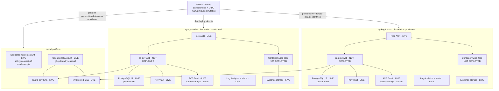
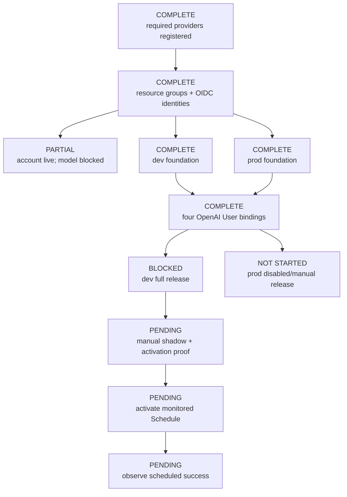

# Deployment architecture and service map

> **State snapshot: 2026-08-14 — FOUNDATIONS + LUNA PROVISIONED; RELEASES
> PENDING.** Bootstrap, both environment foundations, fallback Luna
> deployments, and workload-access bindings are live. No application release,
> Container App, job, schedule, or public Azure application URL exists.

This document is the concise source of truth for current deployment state,
the approved Azure topology, live/planned resource names, and safe operator entry
points. Operational order lives in [`deployment.md`](./deployment.md);
template and identity detail lives in
[`../infra/README.md`](../infra/README.md); release gates live in
[`readiness.md`](./readiness.md).

## Deployment state

| Surface | Current state | Status |
|---|---|---|
| Azure subscription | Runtime selection is **Visual Studio Enterprise Subscription**. Required providers are registered; bootstrap created the three resource groups and four GitHub OIDC identities. Its subscription ID and internal identifiers remain unpublished. | **Bootstrap complete** |
| Region | `westus3` hosts `rg-krypto-platform`, `rg-krypto-dev`, and `rg-krypto-prod`. | **Provisioned** |
| Platform | Dedicated `ai-krypto-westus3` exists with local auth disabled and a verified `CanNotDelete` lock, but remains model-empty after Azure `715-123420`. | [Dedicated-account attempt](https://github.com/VeVarunSharma/project-krypto-dog/actions/runs/31839812884) |
| Model | Operational `krypto-dev-luna` and `krypto-prod-luna` deployments exist on established account `ghcp-foundry-eastus2`: OpenAI `gpt-5.6-luna` `2026-07-09`, `GlobalStandard`, capacity 10 each. Entra plain and strict structured `HOLD` smokes passed. | **Provisioned fallback** |
| Azure dev | Foundation resources and runtime/scheduler/ops identities exist; runtime/ops have Cognitive Services OpenAI User. No release/app/jobs exist. | [Foundation passed](https://github.com/VeVarunSharma/project-krypto-dog/actions/runs/31841581875) |
| Azure prod | Foundation resources and runtime/scheduler/ops identities exist; runtime/ops have Cognitive Services OpenAI User. Production remains disabled with no release/app/jobs; no promotion workflow is shipped or approved. | [Foundation passed](https://github.com/VeVarunSharma/project-krypto-dog/actions/runs/31841960745) |
| Email | Dev and prod ACS Email resources and Azure-managed domains exist as foundation resources. No runtime delivery smoke has run. | **Foundation provisioned** |
| Analytics | Dev temporarily reuses the existing ingestion key, but every event is fail-closed tagged `deployment_environment=dev`; prod uses `prod`. Separate projects remain a future promotion gate. | **Release-testable; promotion-isolation pending** |
| Azure evidence | Live platform/foundation workflow runs exist. No ops-job report, backup, target smoke, activation check, or scheduled execution exists because no release is deployed. | **Foundation evidence only** |
| Historical host | An older Vercel build and a fresh Supabase PostgreSQL replacement were observed previously. Neither is the Azure release candidate. | Historical baseline only |
| Scheduling | No Container Apps Jobs or approved production schedule exist. | **No release** |

GitHub Environments, branch restrictions, and protected values are configured.
Required-reviewer rules are unsupported by the private repository's billing
plan, so mutation workflows remain manual/paused behind configured branch,
exact-SHA, and CI gates.

Describe the bootstrap/account/foundations as provisioned, but do not describe
either application release as deployed until target-smoke evidence passes and
this map is updated.

## Azure topology and release gaps

Runtime and ops user-assigned managed identities authenticate to Foundry
through Microsoft Entra ID. Each receives exactly **Cognitive Services
OpenAI User** at the account scope. Scheduler identities call the app and
receive no direct model role. Foundry local authentication/API keys are
disabled.

### Deployment identity security boundary

Every mutation permission stays at the identity's assigned resource-group
scope:

| Identity | Resource-group roles | Subscription read-only roles |
|---|---|---|
| Platform | `rg-krypto-platform`: Contributor, Role Based Access Control Administrator, Locks Contributor | Project Krypto Provider Registration Reader; Cognitive Services Usages Reader |
| Dev deploy | `rg-krypto-dev`: Contributor, Role Based Access Control Administrator | Project Krypto Provider Registration Reader |
| Prod deploy | `rg-krypto-prod`: Contributor, Role Based Access Control Administrator, Locks Contributor | Project Krypto Provider Registration Reader |
| Prod forced-disable | `rg-krypto-prod`: Contributor | none |

**Project Krypto Provider Registration Reader** is a minimal custom
subscription role containing only
`Microsoft.Resources/subscriptions/providers/read`. It lets the platform, dev,
and prod-deploy workflows run provider `--check-only` without broad Reader or
provider-registration permission. The platform identity additionally reads
live quota through **Cognitive Services Usages Reader**. Prod deploy's
RG-scoped Locks Contributor manages the PostgreSQL, Key Vault, and evidence
storage locks; platform's manages the Foundry account lock.

An authorized subscription owner must run
`.github/scripts/azure/register-providers.sh` before bootstrap. Its required
provider set includes `Microsoft.Network`; workflows only inspect registration
after bootstrap.

## Approved platform contract

| Setting | Approved value |
|---|---|
| Application platform resource group | `rg-krypto-platform` |
| Operational Foundry account | `ghcp-foundry-eastus2` |
| Model region | `eastus2`; application/data foundations remain `westus3` |
| Publisher/model/version | OpenAI `gpt-5.6-luna` `2026-07-09` |
| SKU | `GlobalStandard` |
| Dev deployment | `krypto-dev-luna`, capacity 10 |
| Prod deployment | `krypto-prod-luna`, capacity 10 |
| Upgrade policy | `NoAutoUpgrade` |
| Runtime API | Azure OpenAI v1 base URL ending `/openai/v1` |
| Runtime auth | User-assigned managed identity selected by `AZURE_CLIENT_ID` |

The existing platform fallback was selected only after the dedicated account
returned Azure `715-123420`. The same exact catalog/quota contract applies.
`azure-platform.yml` remains the dedicated-account migration path and verifies
one exact catalog mapping and the desired
aggregate capacity (10 + 10 = 20) against the matching live quota dimension.
It passes both target deployment-name/capacity pairs and subtracts only exact
existing target capacity on the same format/model/version/SKU dimension,
making exact reruns idempotent without crediting unrelated capacity. It has
separate environment-scoped what-if/apply jobs for the account and model
deployments. `azure-platform-access.yml` has its own pair for workload role
bindings. They are currently manual/paused; no required-reviewer enforcement is
available on this repository plan.

## Resource map and live state

Names below are either live foundation resources or planned release resources.

| Resource | Platform/shared | Dev | Prod | Live state |
|---|---|---|---|---|
| Resource group | `rg-krypto-platform` | `rg-krypto-dev` | `rg-krypto-prod` | All live |
| Foundry account | Dedicated `ai-krypto-westus3`; operational `ghcp-foundry-eastus2` | — | — | Both live; operational account hosts models |
| Model deployment | — | `krypto-dev-luna` | `krypto-prod-luna` | Both live on operational account; Entra smokes passed |
| VNet | — | `vnet-krypto-dev` | `vnet-krypto-prod` | Both live |
| Container Apps environment | — | `cae-krypto-dev` | `cae-krypto-prod` | Both live |
| Web app | — | `ca-dev-web` | `ca-prod-web` | Not deployed |
| PostgreSQL server | — | `psql-krypto-dev` | `psql-krypto-prod` | Both live; private PostgreSQL 17 |
| ACR | — | `acrkryptodev` | `acrkryptoprod` | Both live |
| Key Vault | — | `kv-krypto-dev` | `kv-krypto-prod` | Both live |
| Evidence storage | — | `stkryptodevevid` | `stkryptoprodevid` | Both live |
| Communication Service | — | `acs-krypto-dev` | `acs-krypto-prod` | Both live |
| Email Communication Service | — | `email-krypto-dev` | `email-krypto-prod` | Both live with managed domains |
| Hourly job | — | `caj-dev-agent-run` | `caj-prod-agent-run` | Not deployed |
| Daily job | — | `caj-dev-daily-summary` | `caj-prod-daily-summary` | Not deployed |
| Ops jobs | — | `caj-dev-{migrate-init,preflight,verified-backup,target-smoke,activation-check}` | `caj-prod-{migrate-init,preflight,verified-backup,target-smoke,activation-check}` | Not deployed |

The shared ingestion key is temporarily staged for dev and prod, but
`POSTHOG_ENVIRONMENT` is required in production and every event carries
`deployment_environment=dev|prod`. Separate projects remain required before
any future production promotion design.

## Provisioning and release flow

Both foundations and all four operational-account role bindings now exist.
The next gate is the full dev release and retained target-smoke evidence.

Dev schedule activation deploys and validates `schedule-monitoring.bicep` with
the current activation timestamp before `rollout.bicep` may set either job to
`Schedule`. Disable, rollback, and rotation paths first make and verify both
jobs `Manual`, then disable monitoring at boundary `0`.
The same generation plus the exact image digest namespaces hourly scheduled
idempotency, so an old same-hour run cannot satisfy current observation;
run-flow rejects cross-mode replay of an existing key.

Prod deployment and secret rotation share the
`azure-production-mutation` concurrency lock and end disabled/manual. No
executable production promotion workflow is shipped or approved. The
`production-promotion` identity/environment is retained only for the
forced-disable portions of those two workflows; any future promotion requires
a new evidence-bound design and review.

## Database and provider boundaries

- `DATABASE_URL` uses least-privilege `krypto_app`; `DIRECT_URL` uses
  `krypto_owner`. Both address the same private PostgreSQL 17 server/database
  with `sslmode=require`.
- GitHub-hosted runners do not connect to PostgreSQL. VNet-integrated ops jobs
  perform migration, preflight, and backup work.
- ACS connection strings are generated by Azure from the environment's
  Communication Service and written directly to Key Vault. They never transit
  GitHub.
- The runtime receives `AZURE_COMMUNICATION_CONNECTION_STRING`,
  `AZURE_COMMUNICATION_EMAIL_SENDER`, and `ALERT_EMAIL_TO`.
- Foundry runtime configuration is `AZURE_OPENAI_BASE_URL`,
  `AZURE_OPENAI_DEPLOYMENT_NAME`, and `AZURE_CLIENT_ID`; there is no model API
  key.

## Live endpoint register

No URL is recorded until the matching deployment and retained target-smoke
evidence pass.

| Environment | App | Resource group | Public URL | Status |
|---|---|---|---|---|
| Azure dev | `ca-dev-web` (not created) | `rg-krypto-dev` (foundation live) | No URL | **Foundation deployed; release blocked** |
| Azure prod | `ca-prod-web` (not created) | `rg-krypto-prod` (foundation live) | No URL | **Foundation deployed; no release or promotion workflow** |

Do not publish subscription IDs, full Azure resource IDs, PostgreSQL FQDNs,
Key Vault URLs, evidence-container URLs, identity IDs, or other protected
deployment outputs.

## Operator links

| Service | Entry point | Purpose |
|---|---|---|
| GitHub Actions | [Workflow runs](https://github.com/VeVarunSharma/project-krypto-dog/actions) | Platform, access, foundation, release, and evidence runs |
| GitHub Environments | [Environment settings](https://github.com/VeVarunSharma/project-krypto-dog/settings/environments) | Configured environment values and branch restrictions; required reviewers are unavailable on the current plan, so mutation remains manual/paused |
| Azure | [Azure portal](https://portal.azure.com/) | Select **Visual Studio Enterprise Subscription**, then the existing platform/dev/prod resource groups; do not publish internal URLs or IDs |
| Microsoft Foundry | [Foundry portal](https://ai.azure.com/) | Operate `ghcp-foundry-eastus2`; retain `ai-krypto-westus3` for a future dedicated migration |
| PostHog | [PostHog US](https://us.posthog.com/) | Inspect mandatory dev/prod event tags; create a separate dev project before future production promotion |

## Source-of-truth links

- [`deployment.md`](./deployment.md) — ordered operator runbook.
- [`../infra/README.md`](../infra/README.md) — Bicep, identity, secret, and
  monitoring detail.
- [`readiness.md`](./readiness.md) — evidence and release gates.
- [`monitoring.md`](./monitoring.md) — signals and alert behavior.
- [`decisions/0008-azure-native-deployment-architecture.md`](./decisions/0008-azure-native-deployment-architecture.md)
  — accepted Azure architecture decision.
