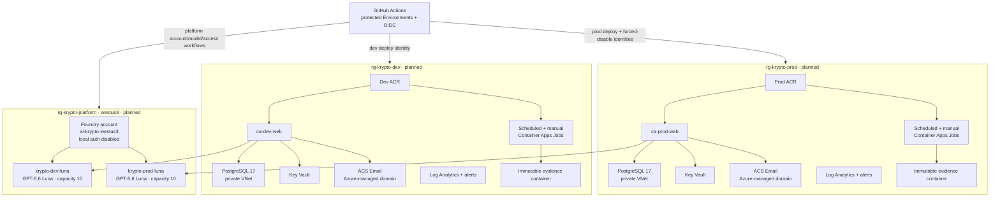
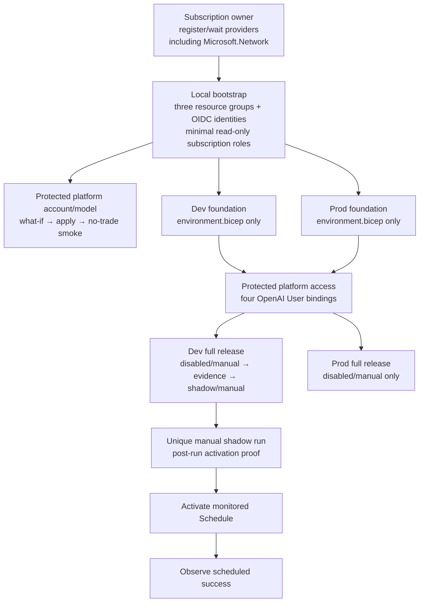

# Deployment architecture and service map

> **State snapshot: 2026-08-14.** The Azure target is implemented in source
> but **not provisioned**. No Project Krypto Azure resource group, Foundry
> account, model deployment, Container App, PostgreSQL server, ACS resource,
> or retained live Azure deployment evidence exists yet. There are no Azure
> application URLs to publish.

This document is the concise source of truth for current deployment state,
the approved Azure topology, planned resource names, and safe operator entry
points. Operational order lives in [`deployment.md`](./deployment.md);
template and identity detail lives in
[`../infra/README.md`](../infra/README.md); release gates live in
[`readiness.md`](./readiness.md).

## Deployment state

| Surface | Current state | Status |
|---|---|---|
| Azure subscription | Runtime selection is **Visual Studio Enterprise Subscription**. Its subscription ID and other internal identifiers stay in protected configuration, never this repository. | Selected; no Project Krypto deployment run |
| Region | `westus3` is the approved region for the platform, dev, and prod resource groups. | Implemented in Bicep; not provisioned |
| Platform | Planned dedicated resource group `rg-krypto-platform` and Foundry account `ai-krypto-westus3`. | **Not provisioned** |
| Model | Planned OpenAI `gpt-5.6-luna` version `2026-07-09`, `GlobalStandard`; `krypto-dev-luna` and `krypto-prod-luna`, capacity 10 each. | **Not deployed** |
| Azure dev | Planned `rg-krypto-dev` foundation, release, and monitored shadow schedule. | **Not provisioned** |
| Azure prod | Planned `rg-krypto-prod` foundation and disabled/manual release. | **Not provisioned; no promotion workflow shipped or approved** |
| Email | Per-environment Azure Communication Services Email resources with Azure-managed domains are declared. | **Not provisioned** |
| Analytics | Dev and prod require distinct PostHog project keys. | Configuration/evidence pending |
| Azure evidence | No live what-if, apply, ops job, backup, provider smoke, target smoke, activation check, or scheduled execution has run. | **None** |
| Historical host | An older Vercel build and a fresh Supabase PostgreSQL replacement were observed previously. Neither is the Azure release candidate. | Historical baseline only |
| Scheduling | No approved Project Krypto production schedule is active. | Disabled |

Do not describe the Azure target as deployed until its workflow has completed
against Azure, retained evidence has been reviewed, and this state map has
been updated.

## Target Azure topology

Runtime and ops user-assigned managed identities authenticate to Foundry
through Microsoft Entra ID. Each receives exactly **Cognitive Services
OpenAI User** at the account scope. Scheduler identities call the app and
receive no direct model role. Foundry local authentication/API keys are
disabled.

### Deployment identity security boundary

Every mutation permission stays at the identity's assigned resource-group
scope:

| Identity | Resource-group roles | Subscription read-only roles |
|---|---|---|
| Platform | `rg-krypto-platform`: Contributor, Role Based Access Control Administrator, Locks Contributor | Project Krypto Provider Registration Reader; Cognitive Services Usages Reader |
| Dev deploy | `rg-krypto-dev`: Contributor, Role Based Access Control Administrator | Project Krypto Provider Registration Reader |
| Prod deploy | `rg-krypto-prod`: Contributor, Role Based Access Control Administrator, Locks Contributor | Project Krypto Provider Registration Reader |
| Prod forced-disable | `rg-krypto-prod`: Contributor | none |

**Project Krypto Provider Registration Reader** is a minimal custom
subscription role containing only
`Microsoft.Resources/subscriptions/providers/read`. It lets the platform, dev,
and prod-deploy workflows run provider `--check-only` without broad Reader or
provider-registration permission. The platform identity additionally reads
live quota through **Cognitive Services Usages Reader**. Prod deploy's
RG-scoped Locks Contributor manages the PostgreSQL, Key Vault, and evidence
storage locks; platform's manages the Foundry account lock.

An authorized subscription owner must run
`.github/scripts/azure/register-providers.sh` before bootstrap. Its required
provider set includes `Microsoft.Network`; workflows only inspect registration
after bootstrap.

## Approved platform contract

| Setting | Approved value |
|---|---|
| Resource group | `rg-krypto-platform` |
| Foundry account | `ai-krypto-westus3` |
| Region | `westus3` |
| Publisher/model/version | OpenAI `gpt-5.6-luna` `2026-07-09` |
| SKU | `GlobalStandard` |
| Dev deployment | `krypto-dev-luna`, capacity 10 |
| Prod deployment | `krypto-prod-luna`, capacity 10 |
| Upgrade policy | `NoAutoUpgrade` |
| Runtime API | Azure OpenAI v1 base URL ending `/openai/v1` |
| Runtime auth | User-assigned managed identity selected by `AZURE_CLIENT_ID` |

`azure-platform.yml` verifies one exact catalog mapping and the desired
aggregate capacity (10 + 10 = 20) against the matching live quota dimension.
It passes both target deployment-name/capacity pairs and subtracts only exact
existing target capacity on the same format/model/version/SKU dimension,
making exact reruns idempotent without crediting unrelated capacity. It has
separate protected what-if/apply jobs for the account and model deployments.
`azure-platform-access.yml` has its own protected what-if/apply pair for
workload role bindings.

## Planned resource map

Every row below is **planned/not provisioned**. Globally unique resource names
remain subject to Azure availability at first deployment.

| Resource | Platform/shared | Dev | Prod |
|---|---|---|---|
| Resource group | `rg-krypto-platform` | `rg-krypto-dev` | `rg-krypto-prod` |
| Foundry account | `ai-krypto-westus3` | — | — |
| Model deployment | — | `krypto-dev-luna` | `krypto-prod-luna` |
| VNet | — | `vnet-krypto-dev` | `vnet-krypto-prod` |
| Container Apps environment | — | `cae-krypto-dev` | `cae-krypto-prod` |
| Web app | — | `ca-dev-web` | `ca-prod-web` |
| PostgreSQL server | — | `psql-krypto-dev` | `psql-krypto-prod` |
| ACR | — | `acrkryptodev` | `acrkryptoprod` |
| Key Vault | — | `kv-krypto-dev` | `kv-krypto-prod` |
| Evidence storage | — | `stkryptodevevid` | `stkryptoprodevid` |
| Communication Service | — | `acs-krypto-dev` | `acs-krypto-prod` |
| Email Communication Service | — | `email-krypto-dev` | `email-krypto-prod` |
| Hourly job | — | `caj-dev-agent-run` | `caj-prod-agent-run` |
| Daily job | — | `caj-dev-daily-summary` | `caj-prod-daily-summary` |
| Ops jobs | — | `caj-dev-{migrate-init,preflight,verified-backup,target-smoke,activation-check}` | `caj-prod-{migrate-init,preflight,verified-backup,target-smoke,activation-check}` |

Each environment has its own PostHog project key. The key is a protected
environment secret, not a Bicep-managed PostHog resource.

## Provisioning and release flow

Both foundations must exist before `azure-platform-access.yml` can bind the
dev/prod runtime and ops principal IDs. A full release before those bindings
would fail Foundry smoke and is not an approved shortcut.

Dev schedule activation deploys and validates `schedule-monitoring.bicep` with
the current activation timestamp before `rollout.bicep` may set either job to
`Schedule`. Disable, rollback, and rotation paths first make and verify both
jobs `Manual`, then disable monitoring at boundary `0`.
The same generation plus the exact image digest namespaces hourly scheduled
idempotency, so an old same-hour run cannot satisfy current observation;
run-flow rejects cross-mode replay of an existing key.

Prod deployment and secret rotation share the
`azure-production-mutation` concurrency lock and end disabled/manual. No
executable production promotion workflow is shipped or approved. The
`production-promotion` identity/environment is retained only for the
forced-disable portions of those two workflows; any future promotion requires
a new evidence-bound design and review.

## Database and provider boundaries

- `DATABASE_URL` uses least-privilege `krypto_app`; `DIRECT_URL` uses
  `krypto_owner`. Both address the same private PostgreSQL 17 server/database
  with `sslmode=require`.
- GitHub-hosted runners do not connect to PostgreSQL. VNet-integrated ops jobs
  perform migration, preflight, and backup work.
- ACS connection strings are generated by Azure from the environment's
  Communication Service and written directly to Key Vault. They never transit
  GitHub.
- The runtime receives `AZURE_COMMUNICATION_CONNECTION_STRING`,
  `AZURE_COMMUNICATION_EMAIL_SENDER`, and `ALERT_EMAIL_TO`.
- Foundry runtime configuration is `AZURE_OPENAI_BASE_URL`,
  `AZURE_OPENAI_DEPLOYMENT_NAME`, and `AZURE_CLIENT_ID`; there is no model API
  key.

## Live endpoint register

No URL is recorded until the matching deployment and retained target-smoke
evidence pass.

| Environment | Planned app | Planned resource group | Public URL | Status |
|---|---|---|---|---|
| Azure dev | `ca-dev-web` | `rg-krypto-dev` | No URL yet | **Not deployed** |
| Azure prod | `ca-prod-web` | `rg-krypto-prod` | No URL yet | **Not deployed** |

Do not publish subscription IDs, full Azure resource IDs, PostgreSQL FQDNs,
Key Vault URLs, evidence-container URLs, identity IDs, or other protected
deployment outputs.

## Operator links

| Service | Entry point | Purpose |
|---|---|---|
| GitHub Actions | [Workflow runs](https://github.com/VeVarunSharma/project-krypto-dog/actions) | Platform, access, foundation, release, and evidence runs |
| GitHub Environments | [Environment settings](https://github.com/VeVarunSharma/project-krypto-dog/settings/environments) | Protected `platform`, `development`, and `production-deploy` gates; `production-promotion` is forced-disable-only |
| Azure | [Azure portal](https://portal.azure.com/) | Select **Visual Studio Enterprise Subscription**, then planned resource groups |
| Microsoft Foundry | [Foundry portal](https://ai.azure.com/) | Planned account/model inspection after provisioning |
| PostHog | [PostHog US](https://us.posthog.com/) | Select the separate dev or prod project |

## Source-of-truth links

- [`deployment.md`](./deployment.md) — ordered operator runbook.
- [`../infra/README.md`](../infra/README.md) — Bicep, identity, secret, and
  monitoring detail.
- [`readiness.md`](./readiness.md) — evidence and release gates.
- [`monitoring.md`](./monitoring.md) — signals and alert behavior.
- [`decisions/0008-azure-native-deployment-architecture.md`](./decisions/0008-azure-native-deployment-architecture.md)
  — accepted Azure architecture decision.
