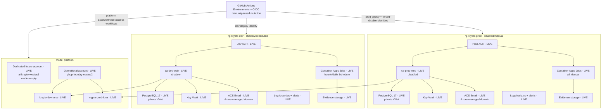
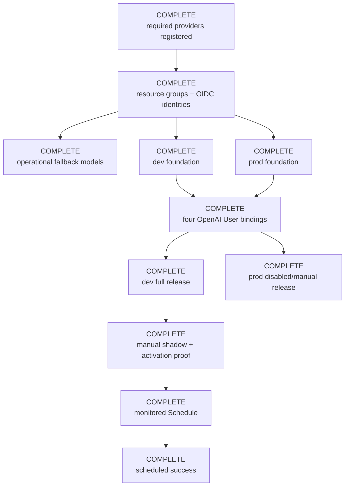

# Deployment architecture and service map

> **State snapshot: 2026-08-15 — DEV SHADOW/SCHEDULED; PRODUCTION
> DISABLED/MANUAL.** Both Azure releases, fallback Luna deployments, workload
> access, target smokes, and retained evidence are live. No paper promotion or
> live-money execution is authorized.

This document is the concise source of truth for current deployment state,
the approved Azure topology, live/planned resource names, and safe operator entry
points. Operational order lives in [`deployment.md`](./deployment.md);
template and identity detail lives in
[`../infra/README.md`](../infra/README.md); release gates live in
[`readiness.md`](./readiness.md).

## Deployment state

| Surface | Current state | Status |
|---|---|---|
| Azure subscription | Runtime selection is **Visual Studio Enterprise Subscription**. Required providers are registered; bootstrap created the three resource groups and four GitHub OIDC identities. Its subscription ID and internal identifiers remain unpublished. | **Bootstrap complete** |
| Region | `westus3` hosts `rg-krypto-platform`, `rg-krypto-dev`, and `rg-krypto-prod`. | **Provisioned** |
| Platform | Dedicated `ai-krypto-westus3` exists with local auth disabled and a verified `CanNotDelete` lock, but remains model-empty after Azure `715-123420`. | [Dedicated-account attempt](https://github.com/VeVarunSharma/project-krypto-dog/actions/runs/31839812884) |
| Model | Operational `krypto-dev-luna` and `krypto-prod-luna` deployments exist on established account `ghcp-foundry-eastus2`: OpenAI `gpt-5.6-luna` `2026-07-09`, `GlobalStandard`, capacity 10 each. Entra plain and strict structured `HOLD` smokes passed. | **Provisioned fallback** |
| Azure dev | `ca-dev-web` is live in `shadow`; hourly/daily jobs are scheduled and monitored. Migration, target smoke, one manual shadow run, activation check, alert dispatch, scheduled success, and post-run zero-trade checks passed. | **Deployed and shadow-ready** |
| Azure prod | `ca-prod-web` is live in `disabled`; all seven jobs are `Manual`. Migration, restore-verified backup, target smoke, exact-digest, zero-trade, and no-schedule checks passed. | **Deployed disabled/manual** |
| Email | Dev and prod ACS Email target smokes returned `sent` and persisted delivery audits. | **Passed** |
| Analytics | Dev and prod target smokes flushed environment-tagged events. A separate production project remains a future promotion gate. | **Deployment smoke passed; promotion isolation pending** |
| Azure evidence | Exact-SHA migration, preflight/smoke, activation, scheduled-run, and backup reports are retained. Production retention is 90 days and remains `Unlocked` pending irreversible approval. | **Release evidence retained** |
| Historical host | An older Vercel build and a fresh Supabase PostgreSQL replacement were observed previously. Neither is the Azure release candidate. | Historical baseline only |
| Scheduling | Dev hourly/daily jobs are `Schedule`; production and all ops jobs remain `Manual`. | **Dev shadow only** |

GitHub Environments, branch restrictions, and protected values are configured.
Required-reviewer rules are unsupported by the private repository's billing
plan. GitHub-hosted jobs were blocked by the account's Actions billing state, so
the first releases used the authenticated operator path with reviewed templates,
immutable image digests, and the same fail-closed evidence validators.
Production deploy remains disabled manually; the proven dev trigger is
configured for use after the billing block is resolved.

## Azure topology and release gaps

Runtime and ops user-assigned managed identities authenticate to Foundry
through Microsoft Entra ID. Each receives exactly **Cognitive Services
OpenAI User** at the account scope. Scheduler identities call the app and
receive no direct model role. Foundry local authentication/API keys are
disabled.

### Deployment identity security boundary

Every mutation permission stays at the identity's assigned resource-group
scope:

| Identity | Resource-group roles | Subscription read-only roles |
|---|---|---|
| Platform | `rg-krypto-platform`: Contributor, Role Based Access Control Administrator, Locks Contributor | Project Krypto Provider Registration Reader; Cognitive Services Usages Reader |
| Dev deploy | `rg-krypto-dev`: Contributor, Role Based Access Control Administrator | Project Krypto Provider Registration Reader |
| Prod deploy | `rg-krypto-prod`: Contributor, Role Based Access Control Administrator, Locks Contributor | Project Krypto Provider Registration Reader |
| Prod forced-disable | `rg-krypto-prod`: Contributor | none |

**Project Krypto Provider Registration Reader** is a minimal custom
subscription role containing only
`Microsoft.Resources/subscriptions/providers/read`. It lets the platform, dev,
and prod-deploy workflows run provider `--check-only` without broad Reader or
provider-registration permission. The platform identity additionally reads
live quota through **Cognitive Services Usages Reader**. Prod deploy's
RG-scoped Locks Contributor manages the PostgreSQL, Key Vault, and evidence
storage locks; platform's manages the Foundry account lock.

An authorized subscription owner must run
`.github/scripts/azure/register-providers.sh` before bootstrap. Its required
provider set includes `Microsoft.Network`; workflows only inspect registration
after bootstrap.

## Approved platform contract

| Setting | Approved value |
|---|---|
| Application platform resource group | `rg-krypto-platform` |
| Operational Foundry account | `ghcp-foundry-eastus2` |
| Model region | `eastus2`; application/data foundations remain `westus3` |
| Publisher/model/version | OpenAI `gpt-5.6-luna` `2026-07-09` |
| SKU | `GlobalStandard` |
| Dev deployment | `krypto-dev-luna`, capacity 10 |
| Prod deployment | `krypto-prod-luna`, capacity 10 |
| Upgrade policy | `NoAutoUpgrade` |
| Runtime API | Azure OpenAI v1 base URL ending `/openai/v1` |
| Runtime auth | User-assigned managed identity selected by `AZURE_CLIENT_ID` |

The existing platform fallback was selected only after the dedicated account
returned Azure `715-123420`. The same exact catalog/quota contract applies.
`azure-platform.yml` remains the dedicated-account migration path and verifies
one exact catalog mapping and the desired
aggregate capacity (10 + 10 = 20) against the matching live quota dimension.
It passes both target deployment-name/capacity pairs and subtracts only exact
existing target capacity on the same format/model/version/SKU dimension,
making exact reruns idempotent without crediting unrelated capacity. It has
separate environment-scoped what-if/apply jobs for the account and model
deployments. `azure-platform-access.yml` has its own pair for workload role
bindings. They are currently manual/paused; no required-reviewer enforcement is
available on this repository plan.

## Resource map and live state

All listed foundation and release resources are live.

| Resource | Platform/shared | Dev | Prod | Live state |
|---|---|---|---|---|
| Resource group | `rg-krypto-platform` | `rg-krypto-dev` | `rg-krypto-prod` | All live |
| Foundry account | Dedicated `ai-krypto-westus3`; operational `ghcp-foundry-eastus2` | — | — | Both live; operational account hosts models |
| Model deployment | — | `krypto-dev-luna` | `krypto-prod-luna` | Both live on operational account; Entra smokes passed |
| VNet | — | `vnet-krypto-dev` | `vnet-krypto-prod` | Both live |
| Container Apps environment | — | `cae-krypto-dev` | `cae-krypto-prod` | Both live |
| Web app | — | `ca-dev-web` | `ca-prod-web` | Both live; dev shadow, prod disabled |
| PostgreSQL server | — | `psql-krypto-dev` | `psql-krypto-prod` | Both live; private PostgreSQL 17 |
| ACR | — | `acrkryptodev` | `acrkryptoprod` | Both live |
| Key Vault | — | `kv-krypto-dev` | `kv-krypto-prod` | Both live |
| Evidence storage | — | `stkryptodevevid` | `stkryptoprodevid` | Both live |
| Communication Service | — | `acs-krypto-dev` | `acs-krypto-prod` | Both live |
| Email Communication Service | — | `email-krypto-dev` | `email-krypto-prod` | Both live with managed domains |
| Hourly job | — | `caj-dev-agent-run` | `caj-prod-agent-run` | Dev Schedule; prod Manual |
| Daily job | — | `caj-dev-daily-summary` | `caj-prod-daily-summary` | Dev Schedule; prod Manual |
| Ops jobs | — | `caj-dev-{migrate-init,preflight,verified-backup,target-smoke,activation-check}` | `caj-prod-{migrate-init,preflight,verified-backup,target-smoke,activation-check}` | All live and Manual |

The shared ingestion key is temporarily staged for dev and prod, but
`POSTHOG_ENVIRONMENT` is required in production and every event carries
`deployment_environment=dev|prod`. Separate projects remain required before
any future production promotion design.

## Provisioning and release flow

Both release contracts and all four operational-account role bindings are
verified. Dev remains shadow-only; production remains disabled/manual.

Dev schedule activation deploys and validates `schedule-monitoring.bicep` with
the current activation timestamp before `rollout.bicep` may set either job to
`Schedule`. Disable, rollback, and rotation paths first make and verify both
jobs `Manual`, then disable monitoring at boundary `0`.
The same generation plus the exact image digest namespaces hourly scheduled
idempotency, so an old same-hour run cannot satisfy current observation;
run-flow rejects cross-mode replay of an existing key.

Prod deployment and secret rotation share the
`azure-production-mutation` concurrency lock and end disabled/manual. No
executable production promotion workflow is shipped or approved. The
`production-promotion` identity/environment is retained only for the
forced-disable portions of those two workflows; any future promotion requires
a new evidence-bound design and review.

## Database and provider boundaries

- `DATABASE_URL` uses least-privilege `krypto_app`; `DIRECT_URL` uses
  `krypto_owner`. Both address the same private PostgreSQL 17 server/database
  with `sslmode=require`.
- GitHub-hosted runners do not connect to PostgreSQL. VNet-integrated ops jobs
  perform migration, preflight, and backup work.
- ACS connection strings are generated by Azure from the environment's
  Communication Service and written directly to Key Vault. They never transit
  GitHub.
- The runtime receives `AZURE_COMMUNICATION_CONNECTION_STRING`,
  `AZURE_COMMUNICATION_EMAIL_SENDER`, and `ALERT_EMAIL_TO`.
- Foundry runtime configuration is `AZURE_OPENAI_BASE_URL`,
  `AZURE_OPENAI_DEPLOYMENT_NAME`, and `AZURE_CLIENT_ID`; there is no model API
  key.

## Live endpoint register

| Environment | App | Resource group | Public URL | Status |
|---|---|---|---|---|
| Azure dev | `ca-dev-web` | `rg-krypto-dev` | https://ca-dev-web.wonderfulmoss-0222e5e1.westus3.azurecontainerapps.io/ | **Shadow; hourly/daily Schedule** |
| Azure prod | `ca-prod-web` | `rg-krypto-prod` | https://ca-prod-web.ambitioussea-a305198e.westus3.azurecontainerapps.io/ | **Disabled; all jobs Manual; no promotion workflow** |

Do not publish subscription IDs, full Azure resource IDs, PostgreSQL FQDNs,
Key Vault URLs, evidence-container URLs, identity IDs, or other protected
deployment outputs.

## Operator links

| Service | Entry point | Purpose |
|---|---|---|
| GitHub Actions | [Workflow runs](https://github.com/VeVarunSharma/project-krypto-dog/actions) | Platform, access, foundation, release, and evidence runs |
| GitHub Environments | [Environment settings](https://github.com/VeVarunSharma/project-krypto-dog/settings/environments) | Configured environment values and branch restrictions; required reviewers are unavailable on the current plan, so mutation remains manual/paused |
| Azure | [Azure portal](https://portal.azure.com/) | Select **Visual Studio Enterprise Subscription**, then the existing platform/dev/prod resource groups; do not publish internal URLs or IDs |
| Microsoft Foundry | [Foundry portal](https://ai.azure.com/) | Operate `ghcp-foundry-eastus2`; retain `ai-krypto-westus3` for a future dedicated migration |
| PostHog | [PostHog US](https://us.posthog.com/) | Inspect mandatory dev/prod event tags; create a separate dev project before future production promotion |

## Source-of-truth links

- [`deployment.md`](./deployment.md) — ordered operator runbook.
- [`../infra/README.md`](../infra/README.md) — Bicep, identity, secret, and
  monitoring detail.
- [`readiness.md`](./readiness.md) — evidence and release gates.
- [`monitoring.md`](./monitoring.md) — signals and alert behavior.
- [`decisions/0008-azure-native-deployment-architecture.md`](./decisions/0008-azure-native-deployment-architecture.md)
  — accepted Azure architecture decision.
