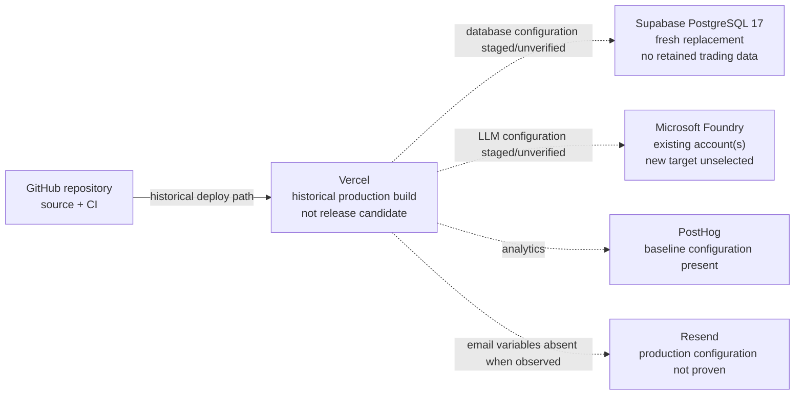
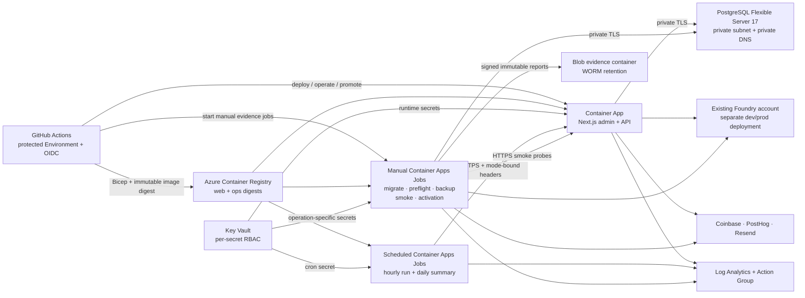
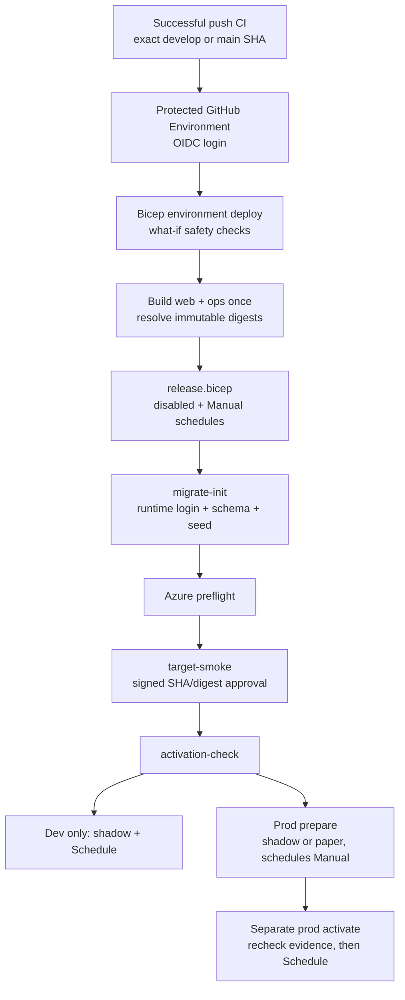

# Deployment architecture and service map

> **State snapshot: 2026-08-12.** The Azure architecture is implemented in
> source at commit `34446fe`, but **no Project Krypto Azure dev or prod
> environment has been provisioned**. There is no Azure Container App URL,
> Azure PostgreSQL target, or Azure deployment evidence to visit yet. The
> hosted system remains the older Vercel/Supabase baseline described below.

This document is the concise source of truth for:

- what is hosted today;
- what exists only as reviewed infrastructure code;
- what the Azure dev/prod target will contain after provisioning; and
- where operators can open the relevant service consoles safely.

Operational sequencing lives in [`deployment.md`](./deployment.md). Bicep
parameters, identity boundaries, and limitations live in
[`../infra/README.md`](../infra/README.md). Release gates live in
[`readiness.md`](./readiness.md).

## Deployment state

| Surface | Current state | Deployment status |
|---|---|---|
| Application | A historical Vercel production build was observed `Ready` on 2026-07-15, but it is about 115 days old and returns `404` from `/api/agent/status`. | **Hosted, not the current release candidate** |
| Database | A fresh Supabase PostgreSQL 17 replacement exists and passed read-only inventory. It has no retained paper-trading history and has not been promoted to serve the Azure release. | **Hosted baseline, intentionally fresh** |
| Scheduling | The fresh Supabase inventory found no active Krypto cron jobs or queued Krypto HTTP requests. | **No approved production schedule active** |
| LLM | Existing Microsoft Foundry account(s) are available, but the account/model/SKU/capacity for the new dev/prod deployments has not been selected. | **Existing shared service; target selection pending** |
| Analytics | PostHog configuration exists in the hosted baseline. No Azure target has emitted telemetry. | **Existing service; Azure evidence pending** |
| Email | Resend variables were absent from the observed Vercel production configuration. | **Not proven for the hosted baseline** |
| Azure source | Bicep, Docker images, application deployment tooling, and six Azure GitHub Actions workflows are committed. | **Implemented and locally validated** |
| Azure dev | `rg-krypto-dev` and the `development` GitHub Environment were absent when checked on 2026-08-12. | **Not provisioned** |
| Azure prod | `rg-krypto-prod`, `production-deploy`, and `production-promotion` were absent when checked on 2026-08-12. | **Not provisioned** |
| Azure evidence | No live Azure `what-if`, deployment, ops job, backup, smoke, or activation report exists. | **None** |

Do not describe the new infrastructure as "deployed" until
[`azure-deploy-dev.yml`](../.github/workflows/azure-deploy-dev.yml) has
completed against Azure and its retained evidence has been reviewed.

## Current hosted baseline

The dashed edges below mean "configured or historically associated, but not
proven for the current release candidate."

This baseline is retained only until the Azure target passes the disabled
deployment gates. Its historical procedure is archived at
[`archive/deployment.vercel-supabase.md`](./archive/deployment.vercel-supabase.md).

## Target Azure topology

The following per-environment topology is declared by
[`environment.bicep`](../infra/environment.bicep),
[`release.bicep`](../infra/release.bicep), and
[`rollout.bicep`](../infra/rollout.bicep). Dev and prod receive separate
resource groups, registries, networks, databases, secret stores, evidence
containers, identities, apps, and jobs. Only the existing Foundry account is
shared, with separate model deployments.

### Intended resource map

All rows are **planned/not provisioned**. ACR, Key Vault, and Storage names
must be globally unique and can change before the first deployment.

| Resource | Dev target | Prod target | Bicep source |
|---|---|---|---|
| Resource group | `rg-krypto-dev` | `rg-krypto-prod` | `bootstrap.bicep` |
| VNet | `vnet-krypto-dev` | `vnet-krypto-prod` | `modules/network.bicep` |
| Container Apps environment | `cae-krypto-dev` | `cae-krypto-prod` | `environment.bicep` |
| Web app | `ca-dev-web` | `ca-prod-web` | `release.bicep` |
| PostgreSQL server | `psql-krypto-dev` | `psql-krypto-prod` | `environment.bicep` |
| ACR parameter | `acrkryptodev` | `acrkryptoprod` | `params/environment.*.bicepparam` |
| Key Vault parameter | `kv-krypto-dev` | `kv-krypto-prod` | `params/environment.*.bicepparam` |
| Evidence storage parameter | `stkryptodevevid` | `stkryptoprodevid` | `params/environment.*.bicepparam` |
| Web model deployment | `krypto-dev-claude` | `krypto-prod-claude` | `platform.bicep` |
| Scheduler jobs | `caj-dev-agent-run`, `caj-dev-daily-summary` | `caj-prod-agent-run`, `caj-prod-daily-summary` | `release.bicep` |
| Ops jobs | `caj-dev-{migrate-init,preflight,verified-backup,target-smoke,activation-check}` | `caj-prod-{migrate-init,preflight,verified-backup,target-smoke,activation-check}` | `release.bicep` |

The first successful environment deployment emits the authoritative resource
IDs, evidence container URL, PostgreSQL FQDN, and Container Apps domain. Keep
those values in deployment outputs/evidence; do not paste credentials,
subscription IDs, private endpoints, or database URLs into this document.

## Release and promotion flow

Production deploy and production activation are separate approvals. No
workflow or Bicep parameter supports live-money execution.

## Database connection contract

The Azure target uses the default `postgres` database initially; no separate
application database resource is declared. Both URLs target the same private
server/database but use different roles:

| Setting | Required identity | Purpose |
|---|---|---|
| `DIRECT_URL` | `krypto_owner` administrator | Migrations, runtime-login bootstrap, preflight inventory, and verified backup only |
| `DATABASE_URL` | `krypto_app` runtime | Web app and idempotent singleton initialization |
| `POSTGRES_ADMIN_PASSWORD` | Password embedded in `DIRECT_URL` | Creates/configures the Flexible Server administrator |
| `RUNTIME_DATABASE_PASSWORD` | Password embedded in `DATABASE_URL` | Creates or rotates `krypto_app` during `migrate-init` |

The two URLs must use `sslmode=require`, and the runtime/admin usernames must
remain distinct. GitHub-hosted runners do not connect directly to the private
database; the VNet-integrated ops jobs perform database operations.

## Live endpoint register

This is the authoritative link register. **No Azure endpoint may be added
until its environment deployment and retained target-smoke evidence pass.**

| Environment | Public application | Azure resources | Evidence | Status |
|---|---|---|---|---|
| Hosted baseline | The concrete historical Vercel URL is intentionally not recorded; select the Project Krypto project in the [Vercel dashboard](https://vercel.com/dashboard) | The fresh database is visible in [Supabase projects](https://supabase.com/dashboard/projects) | See [`readiness.md`](./readiness.md) for the last observed inventory | Historical; not release candidate |
| Azure dev | Not available | Expected resource group `rg-krypto-dev`; open [Azure Resource Groups](https://portal.azure.com/#view/HubsExtension/BrowseResourceGroups) after provisioning | None | **Not deployed** |
| Azure prod | Not available | Expected resource group `rg-krypto-prod`; open [Azure Resource Groups](https://portal.azure.com/#view/HubsExtension/BrowseResourceGroups) after provisioning | None | **Not deployed** |

After the first successful Azure deployment, update only the public Container
App origin in this table and link the corresponding GitHub Actions run. Keep
subscription IDs, full Azure resource IDs, PostgreSQL FQDNs/URLs, Key Vault
URLs, evidence-container URLs, and private endpoints out of this public
repository; operators can resolve them from the protected Bicep deployment
outputs and evidence artifacts.

## Operator links

Concrete project IDs and internal service URLs are deliberately not committed.
Use these safe entry points, then select the resource named in deployment
outputs. GitHub workflow links become active after this branch reaches the
default branch.

| Service | Operator link | Current use |
|---|---|---|
| Repository | [Project Krypto on GitHub](https://github.com/VeVarunSharma/project-krypto-dog) | Source of truth |
| Actions | [Workflow runs](https://github.com/VeVarunSharma/project-krypto-dog/actions) | CI and future Azure deployments |
| Dev deploy workflow | [Azure deploy dev](https://github.com/VeVarunSharma/project-krypto-dog/actions/workflows/azure-deploy-dev.yml) | First target to provision and prove |
| Prod deploy workflow | [Azure deploy prod](https://github.com/VeVarunSharma/project-krypto-dog/actions/workflows/azure-deploy-prod.yml) | Approved disabled-only production releases |
| Prod promotion workflow | [Azure promote prod](https://github.com/VeVarunSharma/project-krypto-dog/actions/workflows/azure-promote-prod.yml) | Separate prepare/activate approvals |
| GitHub Environments | [Environment settings](https://github.com/VeVarunSharma/project-krypto-dog/settings/environments) | Create `platform`, `development`, `production-deploy`, `production-promotion` |
| Actions secrets/variables | [Actions settings](https://github.com/VeVarunSharma/project-krypto-dog/settings/secrets/actions) | Configure OIDC variables and protected secrets |
| Azure resources | [Azure Resource Groups](https://portal.azure.com/#view/HubsExtension/BrowseResourceGroups) | Dev/prod groups do not exist yet |
| Microsoft Foundry | [Microsoft Foundry portal](https://ai.azure.com/) | Select the existing account and reviewed model capacity |
| Vercel | [Vercel dashboard](https://vercel.com/dashboard) | Historical hosted app |
| Supabase | [Supabase projects](https://supabase.com/dashboard/projects) | Fresh hosted PostgreSQL baseline |
| PostHog | [PostHog US](https://us.posthog.com/) | Analytics/operational telemetry |
| Resend | [Resend email activity](https://resend.com/emails) | Alert and daily-summary delivery |

## Source-of-truth links

- [`deployment.md`](./deployment.md) — ordered operator runbook.
- [`../infra/README.md`](../infra/README.md) — Bicep modules, identities,
  secrets, outputs, and limitations.
- [`readiness.md`](./readiness.md) — observed hosted baseline and release gates.
- [`monitoring.md`](./monitoring.md) — operational signals and alerts.
- [`decisions/0008-azure-native-deployment-architecture.md`](./decisions/0008-azure-native-deployment-architecture.md)
  — accepted architecture decision.
